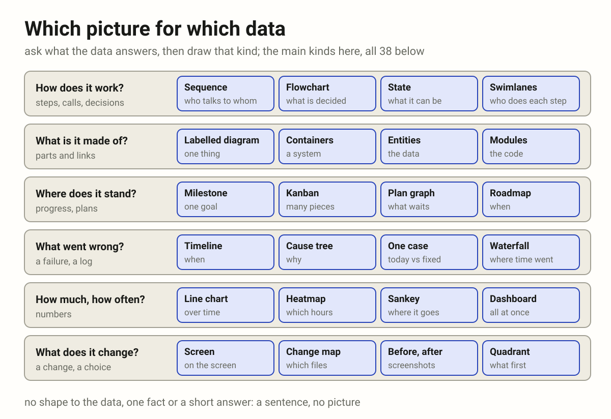

- Tons of text are very hard to read and to understand what stands behind
  them. (2026-10-15 13:28)
- Propose how to use all these diagrams with agents: an instruction for
  agents, so they know how to show data the right way. Which data, with
  what, which diagram for which data. I need to get not text but this kind
  of graphic information, given in graphic form. (2026-10-17 17:50)

# Data as a picture

A reply that carries data shows it as a picture. The author takes in a shape
at a glance, where the same data as a paragraph takes a minute and still
hides how its parts connect. The agent asks what the data answers, picks the
kind of diagram for it, and draws that.

It is one case of [Every point of view](every_point_of_view.md): the
author's story is what they see.

## Why

An agent thinks in text, so it answers in text: steps as a numbered list,
states as sentences, a plan as paragraphs, numbers in a row. The author has
to rebuild the shape in their head: which step waits on which, where the
failure was, what is done and what is not. A picture hands them the shape
itself. Text that holds data is the author's work left undone.

## The rule

1. **Find the data in the reply.** Steps, calls, states, parts, links, a
   plan, a failure, numbers over time, a change: anything with a shape.
2. **Ask what it answers,** and take the kind the chooser below gives. Two
   questions, two pictures; never one picture that answers neither well.
3. **Draw that kind as its page says,** on the
   [diagrams page](https://vbarbarosh.github.io/rules/docs/diagrams.html):
   its parts, its colours, when it does not fit.
4. **Picture first, words after.** The reply opens with the outcome in a line,
   then the picture, then a line of what it shows; lists and logs come last.
5. **Check it before it goes:** every text inside its box, nothing on top of
   anything else, every arrow attached, words as big as the text around it,
   the colours of the page it is shown on. A picture that was not looked at
   was not checked.
6. **No shape, no picture.** One fact, a yes or no, a name, a single number:
   a sentence. A code change: its diff.

## Which picture for which data

- **How does it work?** Steps, calls and decisions:
  [sequence](https://vbarbarosh.github.io/rules/docs/diagrams.html#sequence)
  (who talks to whom, in order),
  [flowchart](https://vbarbarosh.github.io/rules/docs/diagrams.html#flowchart)
  (what is decided where),
  [state](https://vbarbarosh.github.io/rules/docs/diagrams.html#state)
  (what it can be, what moves it),
  [swimlanes](https://vbarbarosh.github.io/rules/docs/diagrams.html#swimlanes)
  (who does each step),
  [pipeline](https://vbarbarosh.github.io/rules/docs/diagrams.html#pipeline)
  (files in, steps, files out),
  [call graph](https://vbarbarosh.github.io/rules/docs/diagrams.html#callgraph)
  (which function calls which).
- **What is it made of, and where does it run?** Parts and links:
  [labelled diagram](https://vbarbarosh.github.io/rules/docs/glossaries.html#MAP-13)
  (one thing and its parts),
  [containers](https://vbarbarosh.github.io/rules/docs/diagrams.html#containers)
  (the parts of a system),
  [cloud](https://vbarbarosh.github.io/rules/docs/diagrams.html#cloud),
  [tiers](https://vbarbarosh.github.io/rules/docs/diagrams.html#tiers),
  [network](https://vbarbarosh.github.io/rules/docs/diagrams.html#network),
  [isometric](https://vbarbarosh.github.io/rules/docs/diagrams.html#isometric)
  (where each part runs),
  [entities](https://vbarbarosh.github.io/rules/docs/diagrams.html#entities)
  (the data and its links),
  [modules](https://vbarbarosh.github.io/rules/docs/diagrams.html#modules)
  and [matrix](https://vbarbarosh.github.io/rules/docs/diagrams.html#matrix)
  (which file or part needs which),
  [data flow](https://vbarbarosh.github.io/rules/docs/diagrams.html#dataflow)
  (where data crosses a trust boundary).
- **Where does it stand?** Progress and plans:
  [milestone](https://vbarbarosh.github.io/rules/docs/diagrams.html#milestone)
  (one goal),
  [kanban](https://vbarbarosh.github.io/rules/docs/diagrams.html#kanban)
  (many pieces of work),
  [plan graph](https://vbarbarosh.github.io/rules/docs/diagrams.html#plangraph)
  (what waits on what),
  [roadmap](https://vbarbarosh.github.io/rules/docs/diagrams.html#roadmap)
  (what is planned when),
  [dashboard](https://vbarbarosh.github.io/rules/docs/diagrams.html#dashboard)
  (many parts at once),
  [versions](https://vbarbarosh.github.io/rules/docs/diagrams.html#versions)
  (which version runs where).
- **What went wrong, and why?** A failure, a log:
  [timeline](https://vbarbarosh.github.io/rules/docs/diagrams.html#timeline)
  (what happened when),
  [chronology](https://vbarbarosh.github.io/rules/docs/diagrams.html#chronology)
  (what one user did, in order),
  [cause tree](https://vbarbarosh.github.io/rules/docs/diagrams.html#causetree)
  (why),
  [one case](https://vbarbarosh.github.io/rules/docs/diagrams.html#case)
  (one request, today beside fixed),
  [questions](https://vbarbarosh.github.io/rules/docs/diagrams.html#questions)
  (what is known and what is not),
  [waterfall](https://vbarbarosh.github.io/rules/docs/diagrams.html#waterfall)
  (where one request spends its time).
- **How much, how often?** Numbers:
  [line chart](https://vbarbarosh.github.io/rules/docs/diagrams.html#linechart)
  (over time),
  [heatmap](https://vbarbarosh.github.io/rules/docs/diagrams.html#heatmap)
  (which days and hours),
  [event plot](https://vbarbarosh.github.io/rules/docs/diagrams.html#eventplot)
  (every event of many actors, at its time),
  [sankey](https://vbarbarosh.github.io/rules/docs/diagrams.html#sankey)
  (where it goes, how much),
  [service map](https://vbarbarosh.github.io/rules/docs/diagrams.html#servicemap)
  (what talks to what, live),
  [flame](https://vbarbarosh.github.io/rules/docs/diagrams.html#flame) and
  [treemap](https://vbarbarosh.github.io/rules/docs/diagrams.html#treemap)
  (where the time or the size goes).
- **What does it change, and what first?**
  [screen](https://vbarbarosh.github.io/rules/docs/diagrams.html#screen)
  (where on the screen), screenshots before and after (what the author
  sees),
  [change map](https://vbarbarosh.github.io/rules/docs/diagrams.html#changemap)
  (which files),
  [quadrant](https://vbarbarosh.github.io/rules/docs/diagrams.html#quadrant)
  (what to do first).
