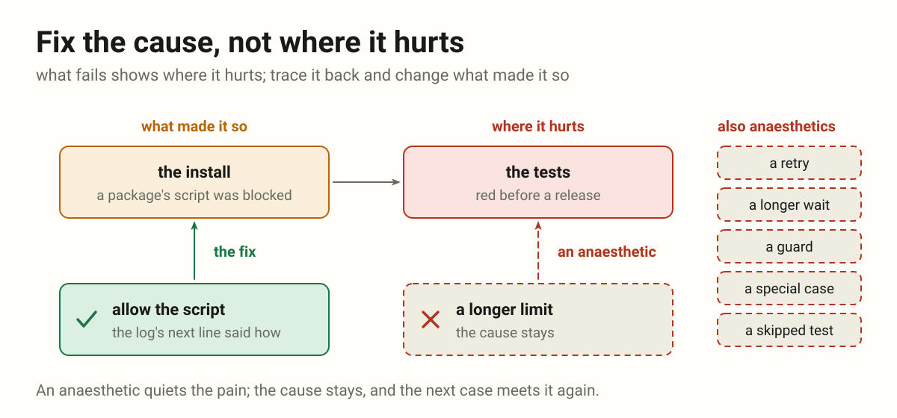

- The first rule is REPRODUCE. NOT GUESS. Do not fix what you cannot
  reproduce. Found a bug: reproduce it first. Reproduced? Now fix. Without
  reproduction do not even try to fix. Without reproduction there is
  nothing to fix. Without reproduction there is nothing to report as broken
  either. (2026-10-29 00:11)
- The main goal: to define what counts as fixing an issue reported from
  production, so that fixes address causes instead of reports.
  (2026-10-29 00:11)
- Instead of fixing the cause, it just sticks crutches on, left and right.
  The cause is what has to be fixed, not the place that hurts. It is not the
  place that hurts that gets numbed with an anaesthetic: work out what
  causes this behaviour. (2026-11-10 22:31)

# Fixing: reproduce it, then fix the cause

Fixing a bug means the system handles one more case. Before a line of fix is
written, the failure is made to happen on demand; then the change goes to
what caused it, not to the place where it showed. Muting the report, or
loosening the test, fixes nothing.

This page is meant to be handed to an agent as it is: "work like this".

## Why

Reading a trace, a diff or the surrounding code produces a hypothesis; only a
reproduction turns it into a fact. A fix built on a hypothesis is a guess
that ships. The reproduction earns its cost several times over:

- It **disproves wrong theories cheaply**, before they become code that has
  to be reverted.
- It tells **when the work is done**: the reproduction stops reproducing.
- It becomes the **regression test**, so the condition cannot come back
  unnoticed.
- It shows the **surrounding facts** otherwise assumed. The state at the
  moment of failure is routinely the opposite of what the code suggests.

## The rule

1. **Reproduce it.** Find the conditions under which the error occurs and
   trigger it deliberately. The breadcrumbs, the release and the affected
   users form the hypothesis; the reproduction confirms it. Trace the
   event's group uid through the logs first
   ([LOG-05](https://vbarbarosh.github.io/rules/docs/rules.html#LOG-05)): it
   shows the whole sequence around the failure.
2. **Name the condition.** State in one sentence what has to be true in the
   world for this to happen. If it cannot be stated, it is not understood
   yet.
3. **Decide the response.** What should the app do when that condition
   holds: retry, wait, re-authenticate, fall back, ask the user? "Nothing"
   is an answer only for conditions outside the app's control, and it still
   needs an outcome the user sees.
4. **Wire the response into the app,** at the cause. The condition is now
   handled: the code has an answer for it.
5. **Only then consider the reporting.** Once the condition is handled, the
   report for that exact case has served its purpose.

No line of fix is written before the first step is done, however obvious the
cause looks from the stack trace. A condition that cannot be reproduced
locally is no permission to skip ahead: add instrumentation that captures
the discriminating facts, ship it, and wait for real data. Observation is a
slower reproduction, not a substitute for one.

## Fix the cause, not where it hurts

**What fails shows where it hurts, not what broke.** A red test, an error on
the screen, a step that hangs: that is where the pain shows. Trace it back to
what made it so, and change that.

- A change only where it shows (a longer limit, a retry, a longer wait, a
  guard, a special case, a test loosened or skipped) is an **anaesthetic**:
  the pain goes quiet, the cause stays, and the next case meets it again.
- **Read the whole log before the first change,** the line after the error
  too. The cause, and often the remedy, is written right beside the pain.
- A cause **out of reach** (another repository, someone else's machine) is
  named, where it is and what it does, and goes to whoever can fix it. A
  stopgap where it hurts only when asked for, and called a stopgap.

For example: before a release the tests went red. The install log held the
cause and the remedy side by side: a package's install script was blocked,
and the next line named the command that allows it. The limit of a test was
stretched instead: four lines, already understood, a release waiting. It
cost a question, a commit of junk and a commit to undo it. The right order
was the other one: make the install right first, and stretch a test only if
that cannot be done.

## Muting is not fixing

- Dropping a report, lowering its level, filtering it in `beforeSend`,
  resolving or archiving the issue, or collapsing it into a single group
  **fixes nothing**. For the muted condition it is the same as not
  monitoring at all.
- Reducing report volume is a **separate task**, valid only after the
  condition is reproduced and handled, and only for the exact cases the
  handling covers.
- A report that still arrives after the fix is **information**, not a
  failure of the fix: the condition occurred for a reason the handling does
  not cover yet.
- The same applies to guards added on a hunch. A `catch` that swallows a
  class of errors because they "look transient" is a mute with better
  manners.

## A fix is one more case the system handles

**Fixing is not making the test mute; it is making the system handle one
more case.** The measure of a fix is the set of inputs the system answers
correctly. A fix grows that set. Anything that leaves the set unchanged is
not a fix, whatever it does to the red.

The same move wears two costumes, and both are mutes:

- **Muting the report:** dropping the event, lowering its level, filtering
  it, resolving the issue.
- **Muting the test:** loosening the assertion, accepting the wrong value as
  expected, marking it skipped, deleting it.

A test that goes green because the expectation moved to meet the code has
reported nothing. The condition still occurs, and now nothing watches it.

Green comes from the other direction: the code learns the case, and the
untouched assertion stops failing. So write the assertion as the outcome the
user should get, watch it fail for the real reason, then teach the system
the case. If the assertion has to change to pass, the change is the finding:
say what new behaviour it now describes, and why that is the right one.

For example: a batch update returned 500 when an item carried a label. The
client updates an item by posting its listing row back with one field
changed, so the labels came back as objects where the handler expected
titles. The test asserted 200 and the labels intact, and stayed exactly as
written; the handler learned to read a title out of either shape. One more
case handled, one assertion never touched.

## Reproduce before naming a defect

The rule is usually read as a rule about writing code. It is also a rule
about writing sentences. Naming something a defect sends a person to look
for it, and that person pays for the claim in hours while the reproduction
would have cost minutes.

**Reproduce before you name it.** A screen that looks wrong, a value that
looks odd, a list that reads strangely: none of that is a defect until the
thing happens on demand.

**What cannot be reproduced is still worth reporting, under its own name.**
Call it an **unreproduced observation**, in those words, and give three
things: what was seen, what was tried, and what is missing. A reader then
knows at once whether an item costs them an investigation or is merely
something noticed.

For example: four items in a library carried the name of a placeholder file,
and a check report called it a naming defect. One upload showed that every
path already named its item correctly; the four records had come from
outside the product. Thirty seconds of checking would have prevented the
claim; without it, it would have become someone's afternoon.

## What an unhandled error means

- An unhandled error means **we are not prepared for this condition**: we do
  not yet know what the app should do about it. It is an open question, not
  a defect in the reporting.
- A stack trace is a **hypothesis about the cause, not the cause**. An
  explanation derived only from reading a trace, a diff or the surrounding
  code is unverified until it is reproduced.
- Event volume measures **how often we are unprepared**, not how broken the
  code is. A high event count is no reason to silence the group.

## What the user sees

- The user must **never see a raw error** for a condition the app can
  recover from: no error modal, no stack trace, no library wording such as
  `Network Error`.
- The worst acceptable outcome is a **visible recovery state**: a preloader,
  a "reconnecting" indicator, a disabled control, something that says the
  app is working on it and the user's data is safe.
- Show a real error only when **recovery is impossible** and the user has to
  make a decision. Then say what happened in their terms and what they can
  do.

## Before calling it fixed

- Can the triggering condition be stated in one sentence?
- Was it reproduced, and does the reproduction stop reproducing after the
  change?
- What does the user see while the app recovers?
- If this error class occurs again for a different reason, does it still
  reach us?
- Is the change where the cause is, or only where it showed?

## Before calling it a defect

- Did it happen on demand, or was it only seen once?
- Was one thing changed at a time between the working case and the broken
  one?
- Was the code path that produces it read, or only the screen that shows it?
- If none of those hold, is it written as an unreproduced observation?
