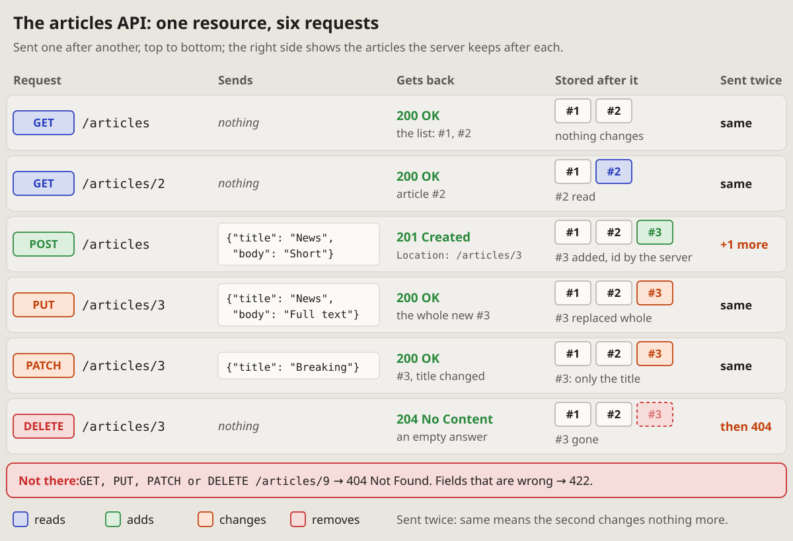

- Make a visual picture of some REST API, a standard one, articles for
  example: create, delete, then full replace, PUT, and PATCH, a partial
  update. Show this API at a glance. (2026-10-17 23:47)
- This one and One request, taken apart: they are compact and expanded
  forms. Let's add them to a new page, APIs. (2026-10-18 00:56)

# Compact: one resource, every request a row

A whole resource on one picture: each request a row, in the order they are
sent, with what it sends, what it gets back and what the server keeps after
it. Which request reads, adds, changes or removes, and what a repeat does,
reads down a column.

## Fits when

- **A resource and its requests:** list, read, add, replace, change,
  remove; the reader learns the API, or checks what it does.
- **The difference between requests matters:** PUT beside PATCH, POST
  beside PUT, what a repeat does.
- **The state after each request** says more than its answer: what is added,
  replaced, gone.

## Not when

- **One request in detail,** its headers and body, an error's answer: the
  [expanded form](expanded.md).
- **The order of calls between parts,** a server, a database, a queue: a
  [sequence diagram](https://vbarbarosh.github.io/rules/docs/diagrams.html#sequence).
- **Many resources at once:** a compact picture each, or a
  [matrix](https://vbarbarosh.github.io/rules/docs/diagrams.html#matrix) of
  addresses by methods.

## How it is drawn

1. **A row per request,** in the order they are sent, on a card of its own:
   the method as a badge, the address in a monospace font.
2. **The method's colour says what it does to the data:** blue reads, green
   adds, orange changes, red removes. A legend under the picture says so.
3. **Five columns:** the request; what it sends (a body in a code box, else
   "nothing"); what it gets back (the status in green, a line on the body);
   what is stored after it (each record a chip, the one touched in the
   method's colour, a removed one faded in a dashed red box); sent twice
   ("same", or what changes more in orange).
4. **One small example of data** runs through every row (articles #1 and
   #2, then #3 added, changed and removed), so each row's change shows.
5. **What fails** goes in a red line under the rows: a record that is not
   there, fields that are wrong, with their statuses.
6. **Around it:** a title with the resource, one line of how to read it.
