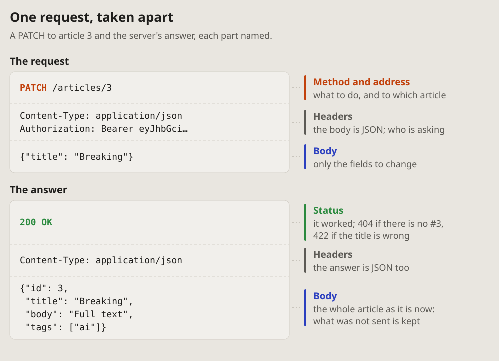
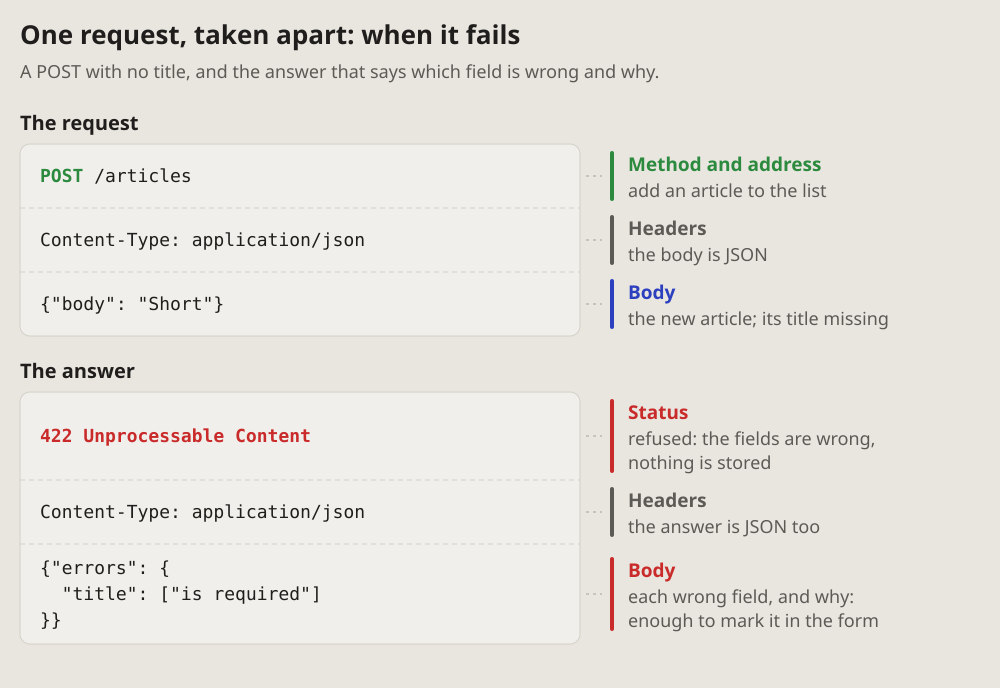

- One request, taken apart: this is a good one. It and the compact table
  are compact and expanded forms. Let's add them to a new page, APIs.
  (2026-10-18 00:56)

# Expanded: one request taken apart

One request and its answer, every part named: the method and address, the
headers, the body, the status. Each part sits in a code box as it is sent,
its name and what it is for beside it, so a reader learns what a request is
made of and what to look at in one.

## Fits when

- **One request matters in detail:** the one a bug is in, the one a client
  has to build, the one the docs explain first.
- **The answer has to be read:** what the status says, what the body holds,
  how an error names the field that is wrong.
- **A newcomer learns the shape** of a request once, to read the
  [compact form](compact.md) after it.

## Not when

- **The whole resource,** all its requests side by side: the
  [compact form](compact.md).
- **Parts talking to each other,** in time order: a
  [sequence diagram](https://vbarbarosh.github.io/rules/docs/diagrams.html#sequence).
- **The difference is one field:** the request and the answer as text, the
  field marked, say it better.

## How it is drawn

1. **Two code boxes,** the request on top and the answer under it, each in
   its parts as they are sent: the first line, the headers, the body. A
   dashed line between the parts.
2. **The name of each part beside it,** on a coloured bar: the method's
   colour on the method and address, green on a status that worked and red
   on one that failed, blue on a body, grey on headers. Under the name, a
   few words on what it is for in this request.
3. **Real values,** short: a token cut with "…", a body with only the fields
   that matter.
4. **A failure is drawn the same way,** the status and the body that names
   what is wrong in red, so the reader sees what a client gets back.
5. **Around it:** a title with what the request does, one line of what it
   shows.

