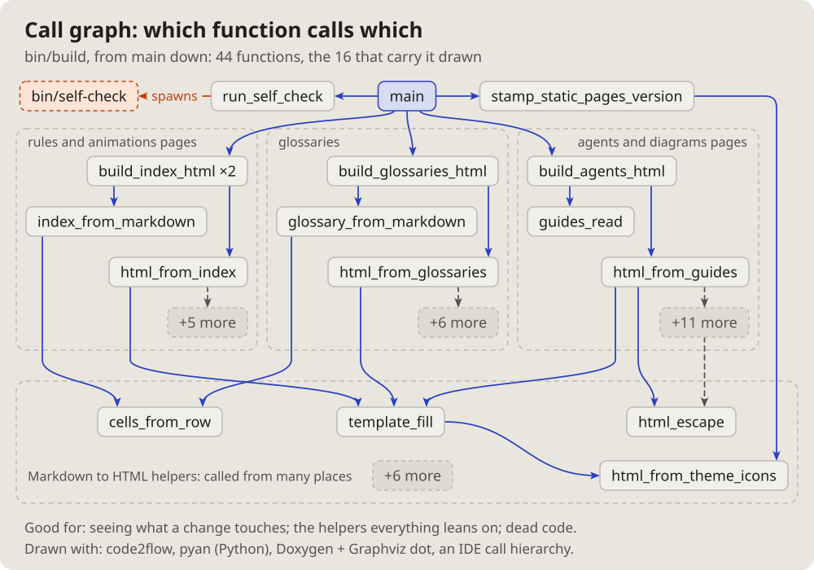

- I will also need a diagram of the topology of, say, some program, some
  script; how can that be done. (2026-10-14 18:15)
- Let us add these pictures to the documentation. Which get used is not
  clear yet, but let them be; we will see. (19:01)

# Call graph: which function calls which

A program from its entry down: each function a box, an arrow to each one
it calls, the related ones framed together, the helpers everything leans
on at the bottom.

## Fits when

- **A change is planned:** what calls the function, what it touches.
- **A newcomer reads a script:** its steps and its shared helpers.
- **Dead code:** a function nothing points at.

## Not when

- **Files, not functions:** a [module graph](modules.md).
- **What the script reads and writes:** a
  [data flow of a script](pipeline.md).
- **Where the time goes:** a [flame graph](flame.md).

## How it is drawn

1. **Layers:** the entry at the top, each call one row lower.
2. **Groups:** light frames for the functions of one step.
3. **Too many:** the main ones drawn, the rest a "+N more" box.
