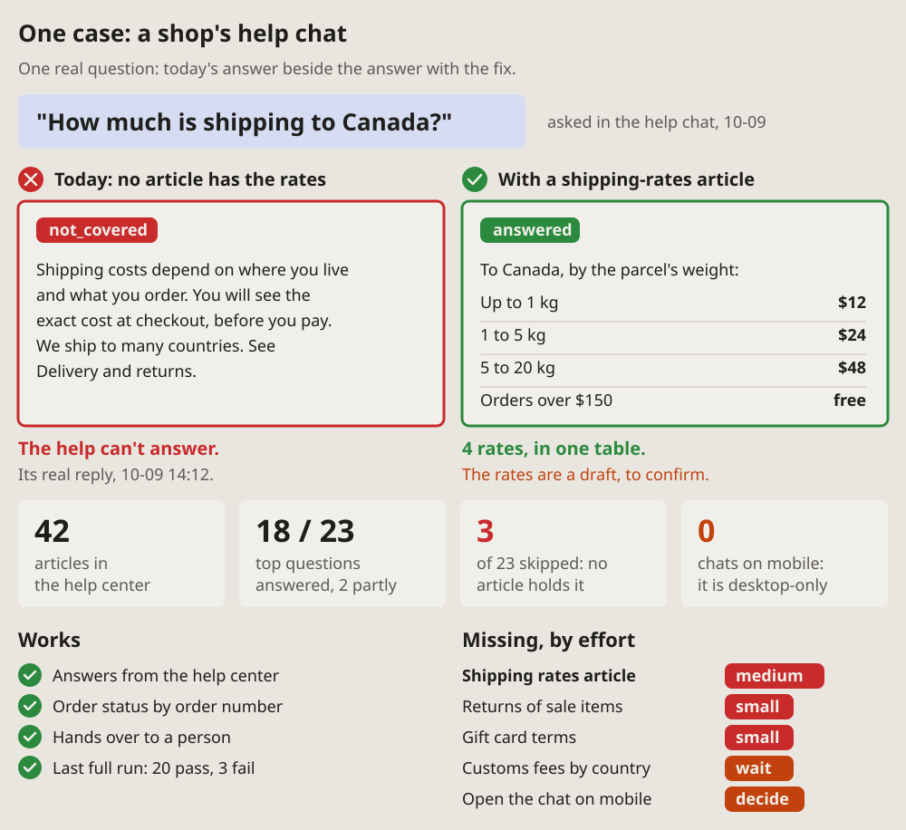

- Add all of them, only make them anonymous: nothing about the company or
  anything personal. (2026-10-14 23:56, of the visual-lang drafts)

# One case: today beside fixed

One real request, its answer today beside its answer with the fix: the
question on top, two framed panels under it, red for today and green for
the fix. Big numbers and what works and what is missing follow, so the one
case stands for the rest.

## Fits when

- **One real request shows the gap:** a question a help chat cannot
  answer, a call that fails, a search that finds nothing.
- **The fix is content or data,** and its effect is the answer itself: a
  table, a value, a reply.
- **The author must decide what to do next:** the case convinces, the
  lists say what else is open and what each costs.

## Not when

- **The course of messages between parts** changes, not the answer: a
  [sequence diagram](sequence.md), today beside proposed.
- **Many parts at once,** each with its state: a
  [status dashboard](dashboard.md).
- **A change on screen:** two screenshots, before and after.

## How it is drawn

1. **The question:** quoted big in a soft blue box, where it was asked and
   when in grey beside it. The real words, not a summary.
2. **Today:** a red frame, a red cross in a circle and "Today:" with why it
   fails; inside, the real answer as given and a red tag ("not_covered").
3. **With the fix:** a green frame, a green tick and "With" and the fix;
   inside, the answer it would give and a green tag ("answered"). Values
   go in a small table, a line between rows.
4. **A verdict under each:** in bold, red or green, what the panel shows;
   a line under it says where the real answer was seen, or in amber what
   is still to confirm.
5. **KPI cards:** four big numbers for the whole, each a few words of what
   it counts; red or amber for a count that stands for a gap.
6. **Two lists:** "Works" with green ticks; "Missing, by effort" with a
   pill per item, red for work to do (small, medium), amber for what waits
   on an answer (wait, check, decide). The item the case is about first,
   in bold.
7. **Ticks and crosses** are drawn as paths, not typed as glyphs, so every
   font shows them alike.
