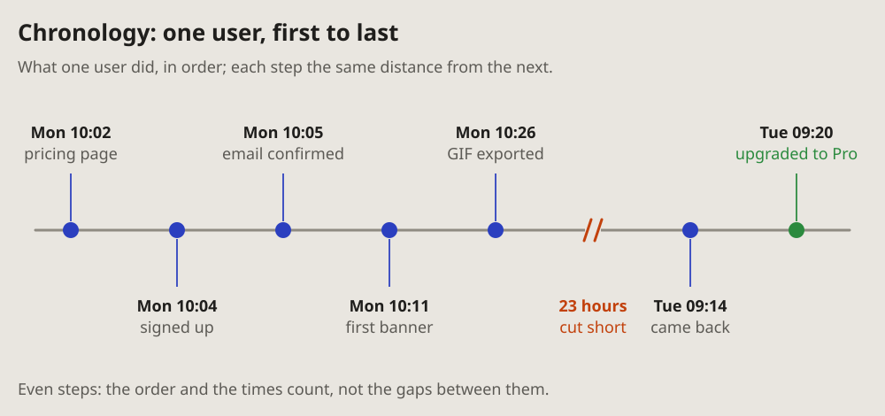
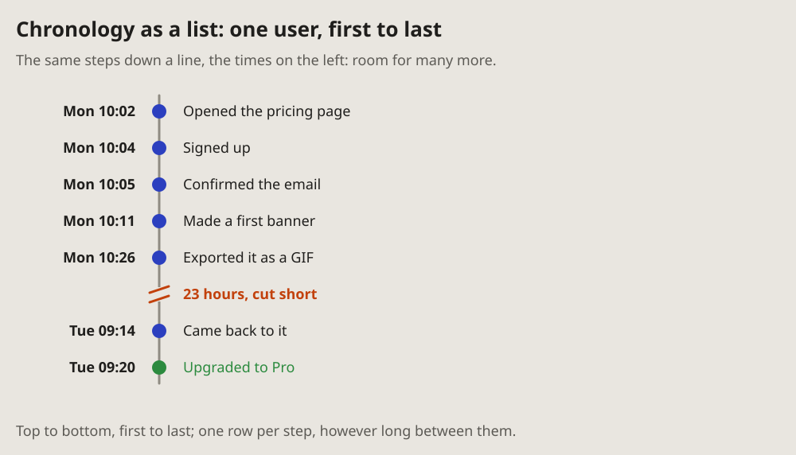

- A new term, chronology. Make a diagram for it and show several variants
  of such diagrams. (2026-10-19 10:20)
- A chronology diagram can probably show a user's actions over time: first
  they did one thing, then another, then a third. (10:24)
- Chronology: C, the strip. (10:26)
- I see the definition of chronology, but I don't see chronology among the
  diagrams. There should be a diagram for chronology. (18:51)
- And about chronology: I remember there were two views of it; on the page
  I see only one. (18:52)

# Chronology: what one user did, in order

Steps in the order they happened, each with its time, at even distances:
the order and the times count, not the gaps between them. A long gap is
cut short, its length written on the cut.

For more steps than a strip holds, the same chronology goes down a line,
the times on the left, one row per step.

## Fits when

- **One actor's steps:** a user, a job, an agent; first this, then that.
- **The order matters more than the distances:** a minute and a night
  between two steps take the same room.
- **Steps far apart in time:** minutes, then a day, then a week; a
  [timeline](timeline.md) would squeeze the short ones flat.

## Not when

- **The gaps are the story:** a wait, a timeout, what happened while
  something else waited: a [timeline](timeline.md).
- **Several parts pass something between them:** a
  [sequence diagram](sequence.md).
- **The states matter, not the steps:** a [state diagram](state.md).

## How it is drawn

1. **The line:** one grey line, left to right in the strip, top to bottom
   in the list.
2. **Steps:** a dot each, at even distances. In the strip, a stem to its
   label, the time in bold above a few words, the labels above and below
   in turn; in the list, the time on the left, the words on the right.
3. **Colours:** blue for each step, green for the end that is wanted, red
   for a step that went wrong.
4. **A long gap:** the line cut by two slanted amber strokes, its length
   written in amber on the cut.
5. **Strip or list:** a strip up to seven or eight steps; more, the list.
