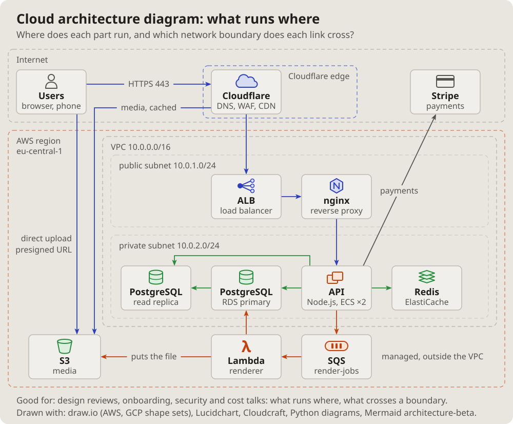

- I am more interested in the topology of computer systems: some complex
  architecture with queues, Cloudflare, S3, Lambda, proxies, load
  balancers, databases, all of that. (2026-10-14 18:13)
- Let us add these pictures to the documentation. Which get used is not
  clear yet, but let them be; we will see. (19:01)

# Cloud architecture diagram: what runs where

The parts of a system inside the places they run: the internet, a CDN's
edge, a cloud region, its network and subnets, the managed services
beside it. Each part an icon with its name, the links as arrows.

## Fits when

- **The question is where:** which region, which network, which subnet a
  part runs in, and what is managed by the cloud.
- **A link crosses a boundary:** from the internet into the network, out
  to an outside service.
- **A design review or a newcomer** needs the whole system on one page.

## Not when

- **What each part does** matters more than where: a
  [C4 container diagram](containers.md).
- **Ports and who may connect:** a [network diagram](network.md).
- **The order of the calls:** a [sequence diagram](sequence.md).

## How it is drawn

1. **The places:** nested dashed frames, each named inside at its top
   left: the internet, the edge, the region, the network, the subnets.
2. **Parts:** a small icon over the name and one line of what it is.
3. **Links:** the project's arrows, coloured by kind (requests blue,
   data green, background jobs orange), a few words on the long ones.
