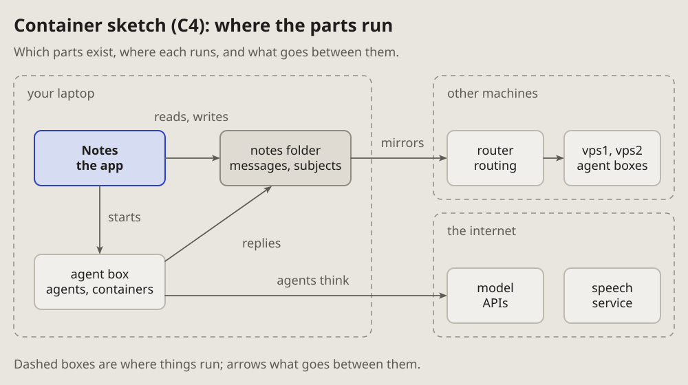
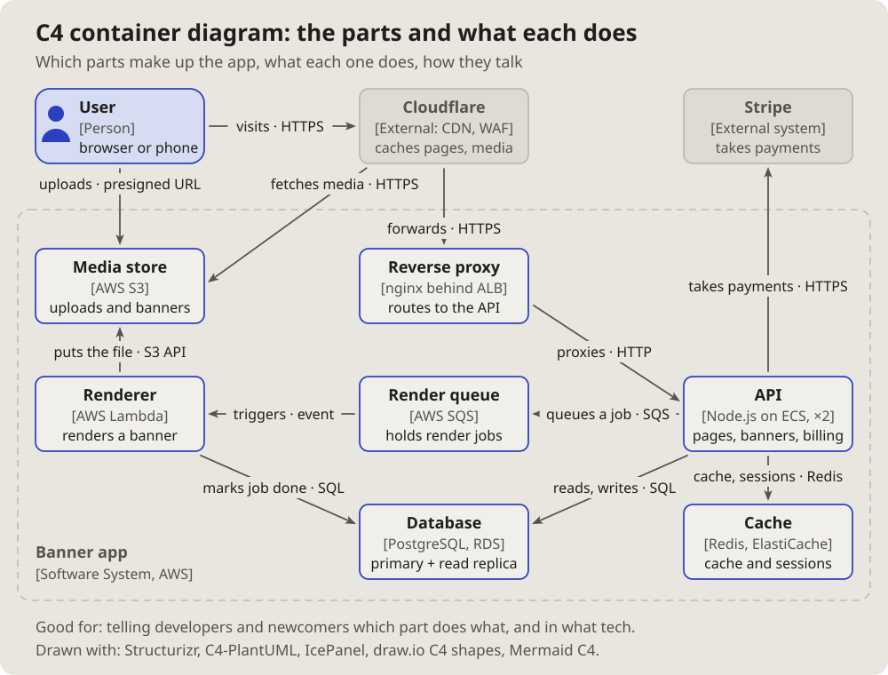

- Add all five. (2026-10-13, as the note of 16:29 quotes it)
- The new diagrams, I think, should go on the pages too, only in the same
  format as the other diagrams; and mind the arrows: take the ones the
  project uses. (16:33)

# Container sketch (C4): where the parts run

Which parts a system has, where each one runs, and what goes between them:
the container level of the C4 model, drawn as a sketch.

## Fits when

- **The question is where:** which machine, which box, which service runs
  a part.
- **Something crosses a boundary:** a laptop to a server, a box to the
  internet, and what goes across.
- **A newcomer needs the whole** before any one part.

## Not when

- **The order of the calls** matters: a [sequence diagram](sequence.md).
- **The data and how it links** is the question: an
  [entity-relationship diagram](entities.md).
- **The inside of one part:** its states or its decisions, a
  [state diagram](state.md) or a [flowchart](flowchart.md).

## How it is drawn

1. **Where things run:** dashed boxes with their names at the top left (a
   laptop, other machines, the internet).
2. **Parts:** boxes inside them, a name and one line of what each is; the
   one the reply is about in blue.
3. **What goes between them:** the project's arrows, grey, each with a few
   words.
4. **Names:** the standard ones from the
   [glossary of names](https://vbarbarosh.github.io/rules/docs/glossaries.html#NAME) (laptop, router, vps1,
   box), never a private host.

## Examples

