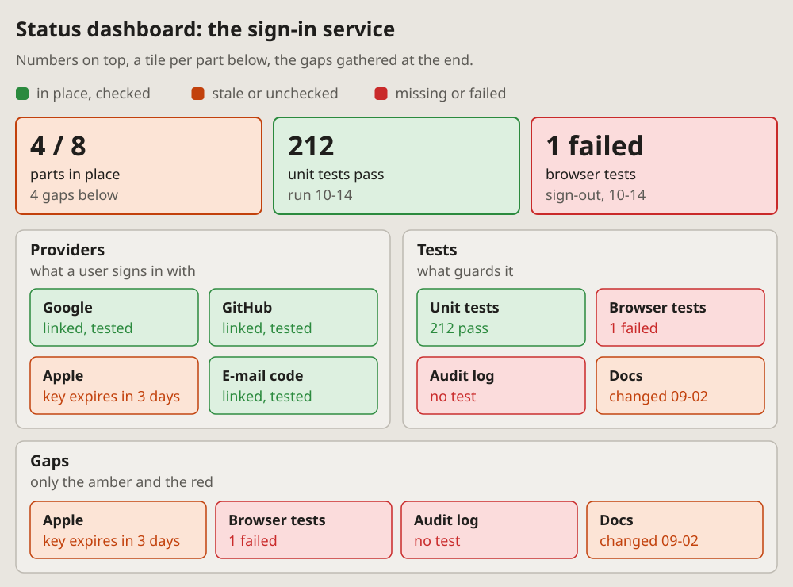
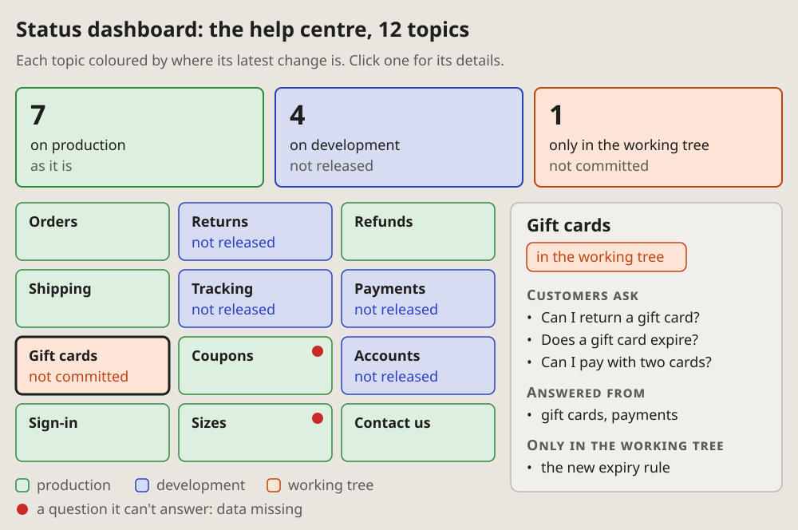
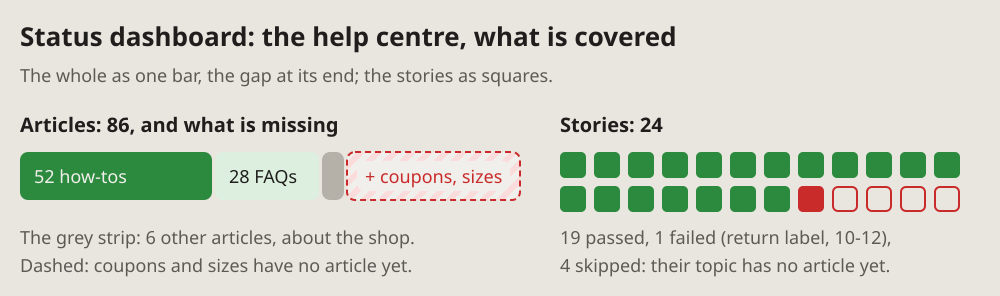

- Let's add it to the diagrams too, but first make a few sketches.
  (2026-10-14 13:45, of a status dashboard)
- Sketch: A, the full dashboard. (13:49)
- Add all of them, only make them anonymous: nothing about the company or
  anything personal. (2026-10-14 23:56, of the visual-lang drafts)

# Status dashboard: where each part stands

A RAG status dashboard (red, amber, green): the state of many parts at
once, each a tile coloured by its state. Big numbers on top, the tiles
grouped below, the gaps gathered at the end. Two more kinds at the end:
tiles coloured by where each part is, and a whole beside its gap.

## Fits when

- **The question is where things stand:** many parts, each in place,
  stale or missing.
- **The reader must find the gaps fast:** a project's checks, a release,
  an audit of what is covered.
- **The same view is read again later,** and the colours show what moved.

## Not when

- **One thing and its states over time:** a [state diagram](state.md).
- **What happened in what order:** a [timeline](timeline.md) or a
  [sequence diagram](sequence.md).
- **A few parts only:** a sentence or a list says it; a dashboard needs
  enough tiles to scan.

## How it is drawn

1. **The key:** green in place and checked, amber stale or unchecked, red
   missing or failed, in one line under the title.
2. **KPI cards:** three or four big numbers on top, each a word of what it
   counts and a line of context, coloured like the worst it stands for.
3. **The status board:** a panel per area, its name and a line of what it
   holds; a tile per part, its name in bold and its state in its colour.
4. **The gaps:** the amber and red tiles again, gathered in a panel at the
   end, so the reader does not hunt for them.
5. **Real states only:** a tile's word says why it has its colour ("1
   failed", "no test"), never just "bad".

## Coloured by where it is

When the question is where each part is, not how it is, the colours name
places: production, development, the working tree. The list behind a tile
opens on a click, in a panel beside the grid.

1. **A card per place,** in the colour its tiles get: green, on production
   as it is; blue, on development and not released; amber, only in the
   working tree and not committed.
2. **Each tile in the colour of its latest change:** its name in bold, a
   small word for what is not out yet ("not released").
3. **A red dot** on a tile: a question it cannot answer, its data missing.
4. **The key** under the grid, the red dot in it too.
5. **Details on a click:** the chosen tile gets a dark outline; the panel
   beside the grid shows its name, a tag of where it is, and short
   sections, headed in small caps, of a few bullets each. The tile never
   grows to hold its list.

## A whole and its gap

When the question is how much is covered, one bar shows the whole and
what is missing from it; a row of squares counts the runs.

- **The bar:** a segment per kind, as wide as its count, dark green, light
  green, a thin strip for the rest.
- **The gap:** a dashed red segment at the end, hatched soft red, its
  label on a pill: "+ coupons, sizes".
- **A grey line under the bar** names the strip and the dashed part.
- **Units as squares,** in rows: filled green passed, filled red failed,
  empty with a red outline skipped. A grey line under them says which
  failed, when, and why the rest were skipped.
