- Which diagrams does it have that we lack? (2026-11-14 17:28, of
  diagramdesign.dev)
- Show them in our colour palette. (17:39)
- Add these pictures to the repository, and give each picture its
  credit; the link to the repository goes there too, as a credit, a
  reference. (18:45)

# Diagram Design: 25 kinds this page has no guide for

[diagram-design](https://github.com/cathrynlavery/diagram-design) is an
agent skill that draws 50 kinds of diagram, each a page with one SVG
written by hand. These are the 25 this page has no guide for, each in
diagram-design's own example, recoloured into this page's colours, light
and dark; the shapes, words and sizes are its own. They are not guides
yet: a kind this page takes in gets a guide of its own.

## How it works

**Process:** a step per box in the lane of the team that does it,
numbered across the top, the data each hands on as a tag; the critical
hand-off in the accent. Credit: diagram-design's
[example-process.html](https://github.com/cathrynlavery/diagram-design/blob/f6db0decea96de66b901331a0f79a8d4b147ebae/skills/diagram-design/assets/example-process.html),
© 2025 Cathryn Lavery, MIT licence, recoloured.

**Service blueprint:** a path in stages, what the customer does and sees
above the line of visibility, what runs backstage below it; the step that
fails in the accent. Credit: diagram-design's
[example-service-blueprint.html](https://github.com/cathrynlavery/diagram-design/blob/f6db0decea96de66b901331a0f79a8d4b147ebae/skills/diagram-design/assets/example-service-blueprint.html),
© 2025 Cathryn Lavery, MIT licence, recoloured.

**User journey:** a person's stages across, their actions and touchpoints
under each, a line of how they feel that dips where it hurts. Credit:
diagram-design's
[example-journey.html](https://github.com/cathrynlavery/diagram-design/blob/f6db0decea96de66b901331a0f79a8d4b147ebae/skills/diagram-design/assets/example-journey.html),
© 2025 Cathryn Lavery, MIT licence, recoloured.

**Event modelling:** time left to right; for each stage the command, the
event it leaves, named in the past tense, and the view read from that
event. Credit: diagram-design's
[example-event-modeling.html](https://github.com/cathrynlavery/diagram-design/blob/f6db0decea96de66b901331a0f79a8d4b147ebae/skills/diagram-design/assets/example-event-modeling.html),
© 2025 Cathryn Lavery, MIT licence, recoloured.

## What it is made of

**Nested:** scopes inside scopes, the widest outside, the one that
matters innermost. Credit: diagram-design's
[example-nested.html](https://github.com/cathrynlavery/diagram-design/blob/f6db0decea96de66b901331a0f79a8d4b147ebae/skills/diagram-design/assets/example-nested.html),
© 2025 Cathryn Lavery, MIT licence, recoloured.

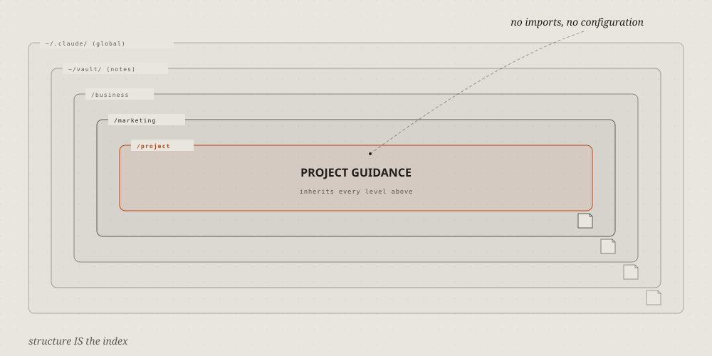

**Layer stack:** levels as bands one on another, the lowest at the
bottom; the layer that matters in the accent. Credit: diagram-design's
[example-layers.html](https://github.com/cathrynlavery/diagram-design/blob/f6db0decea96de66b901331a0f79a8d4b147ebae/skills/diagram-design/assets/example-layers.html),
© 2025 Cathryn Lavery, MIT licence, recoloured.

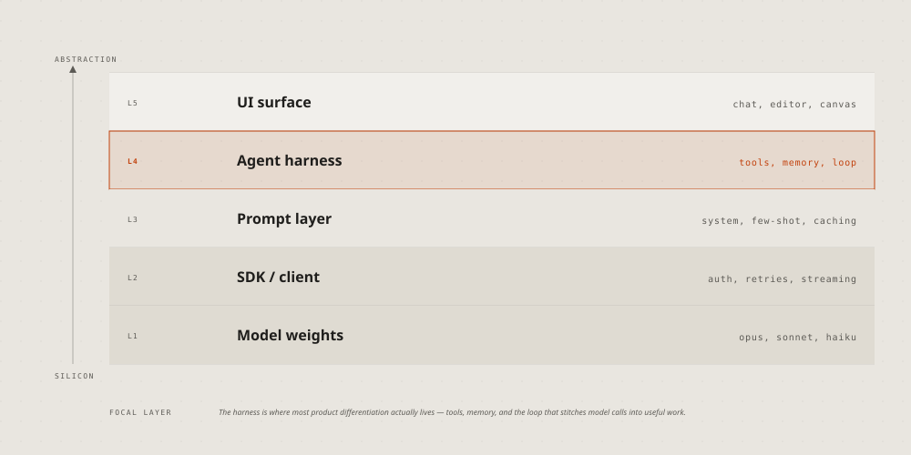

**Org chart:** who reports to whom, a row per level, lines down from each
lead. Credit: diagram-design's
[example-org-chart.html](https://github.com/cathrynlavery/diagram-design/blob/f6db0decea96de66b901331a0f79a8d4b147ebae/skills/diagram-design/assets/example-org-chart.html),
© 2025 Cathryn Lavery, MIT licence, recoloured.

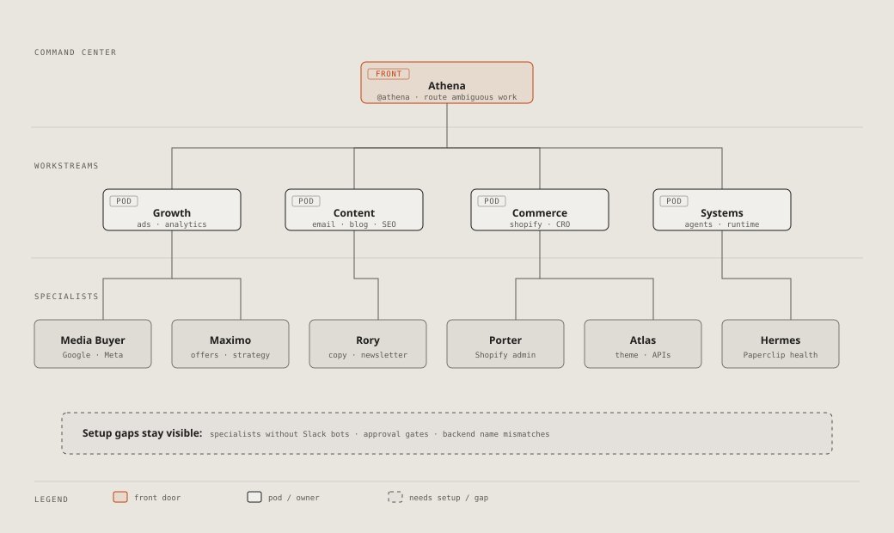

**Database schema:** a box per table, its columns, types and keys; a line
from each foreign key to the key it names, a group per schema. Credit:
diagram-design's
[example-db-schema.html](https://github.com/cathrynlavery/diagram-design/blob/f6db0decea96de66b901331a0f79a8d4b147ebae/skills/diagram-design/assets/example-db-schema.html),
© 2025 Cathryn Lavery, MIT licence, recoloured.

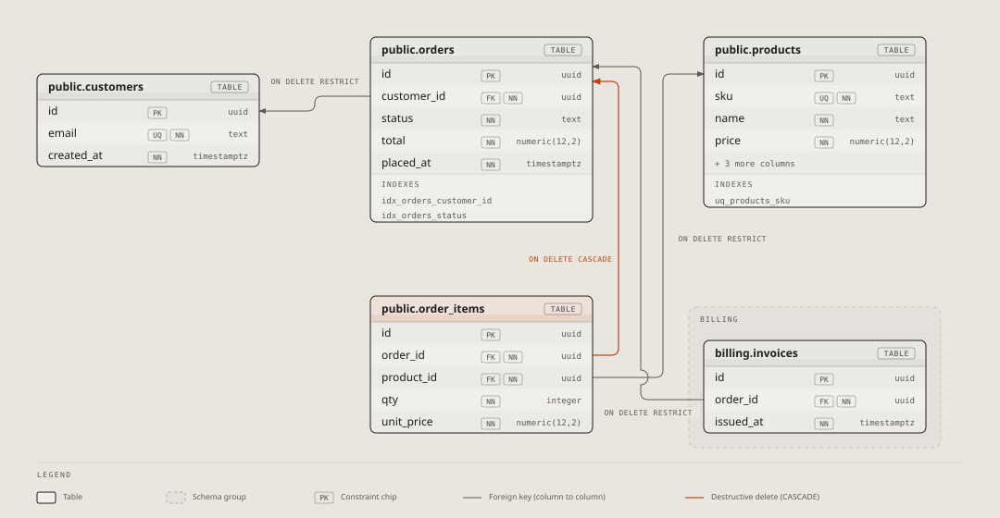

**Exploded view:** one thing's layers pulled apart in depth, each named
at the side. Credit: diagram-design's
[example-exploded.html](https://github.com/cathrynlavery/diagram-design/blob/f6db0decea96de66b901331a0f79a8d4b147ebae/skills/diagram-design/assets/example-exploded.html),
© 2025 Cathryn Lavery, MIT licence, recoloured.

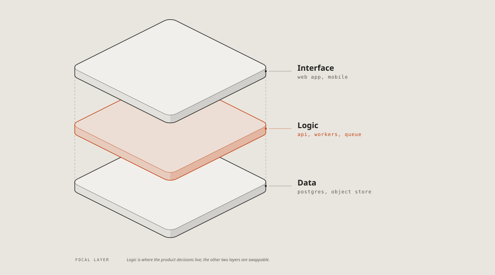

**Axonometric plan:** a floor or a site from above, at an angle, its
rooms named; the one under discussion in the accent. Credit:
diagram-design's
[example-axonometric-plan.html](https://github.com/cathrynlavery/diagram-design/blob/f6db0decea96de66b901331a0f79a8d4b147ebae/skills/diagram-design/assets/example-axonometric-plan.html),
© 2025 Cathryn Lavery, MIT licence, recoloured.

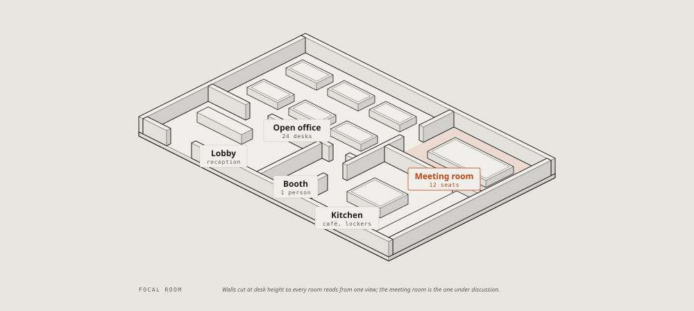

## Where it stands

**Story map:** the user's activities across as a backbone, the stories
under each, cut into releases by lines; the riskiest story marked.
Credit: diagram-design's
[example-story-map.html](https://github.com/cathrynlavery/diagram-design/blob/f6db0decea96de66b901331a0f79a8d4b147ebae/skills/diagram-design/assets/example-story-map.html),
© 2025 Cathryn Lavery, MIT licence, recoloured.

**Traceability:** each need traced by its id to the design that meets it
and the test that checks it; a need with no test in the accent. Credit:
diagram-design's
[example-requirement-traceability.html](https://github.com/cathrynlavery/diagram-design/blob/f6db0decea96de66b901331a0f79a8d4b147ebae/skills/diagram-design/assets/example-requirement-traceability.html),
© 2025 Cathryn Lavery, MIT licence, recoloured.

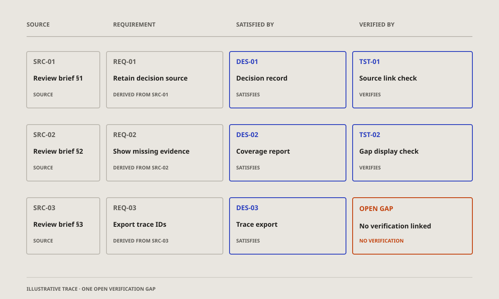

## What it changes

**Wardley map:** the parts of a product from what the user sees down to
what nobody sees, placed by how mature each is, from new to commodity; an
arrow where one is moving. Credit: diagram-design's
[example-wardley.html](https://github.com/cathrynlavery/diagram-design/blob/f6db0decea96de66b901331a0f79a8d4b147ebae/skills/diagram-design/assets/example-wardley.html),
© 2025 Cathryn Lavery, MIT licence, recoloured.

## How much

**Scatter plot:** two numbers per item, a dot each, the trend as a line;
the one that matters named. Credit: diagram-design's
[example-scatter.html](https://github.com/cathrynlavery/diagram-design/blob/f6db0decea96de66b901331a0f79a8d4b147ebae/skills/diagram-design/assets/example-scatter.html),
© 2025 Cathryn Lavery, MIT licence, recoloured.

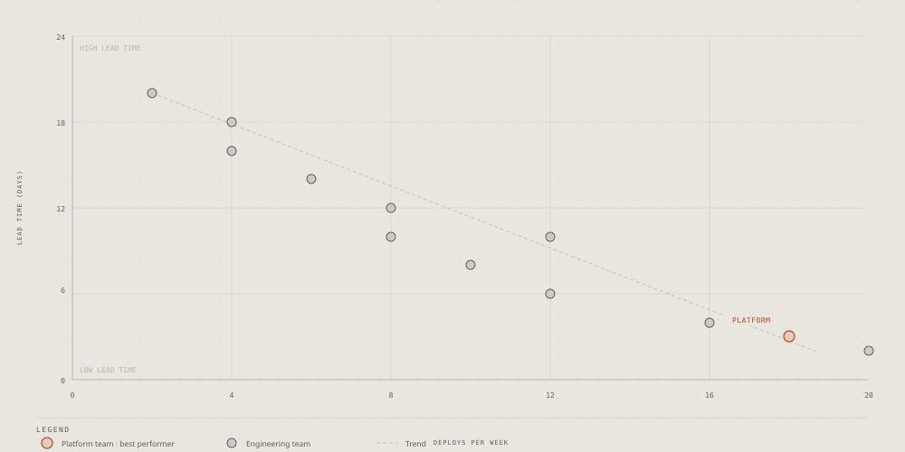

**Radar:** a few options scored on three to six criteria, a shape per
option on the spokes. Credit: diagram-design's
[example-radar.html](https://github.com/cathrynlavery/diagram-design/blob/f6db0decea96de66b901331a0f79a8d4b147ebae/skills/diagram-design/assets/example-radar.html),
© 2025 Cathryn Lavery, MIT licence, recoloured.

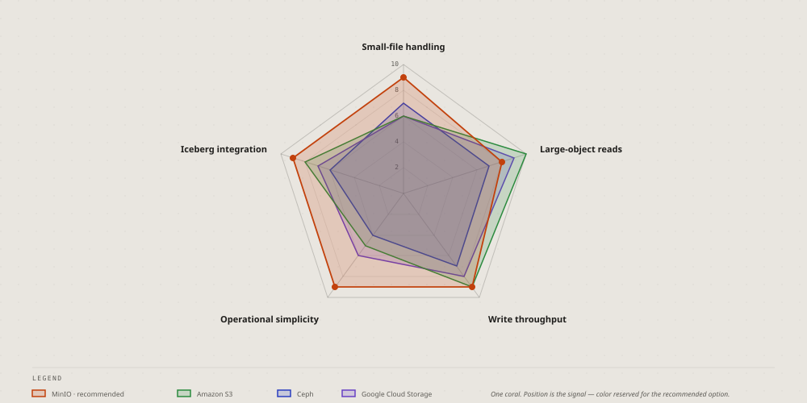

**Polar chart:** one number around a cycle, the hours of a day as
spokes; the peak in the accent. Credit: diagram-design's
[example-polar.html](https://github.com/cathrynlavery/diagram-design/blob/f6db0decea96de66b901331a0f79a8d4b147ebae/skills/diagram-design/assets/example-polar.html),
© 2025 Cathryn Lavery, MIT licence, recoloured.

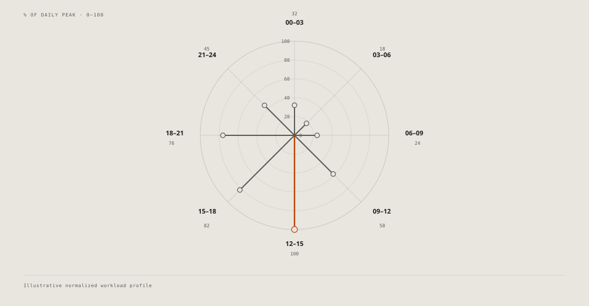

**Pyramid:** levels from a wide base to a narrow top, the rare and
valuable at the apex; turned over, a funnel. Credit: diagram-design's
[example-pyramid.html](https://github.com/cathrynlavery/diagram-design/blob/f6db0decea96de66b901331a0f79a8d4b147ebae/skills/diagram-design/assets/example-pyramid.html),
© 2025 Cathryn Lavery, MIT licence, recoloured.

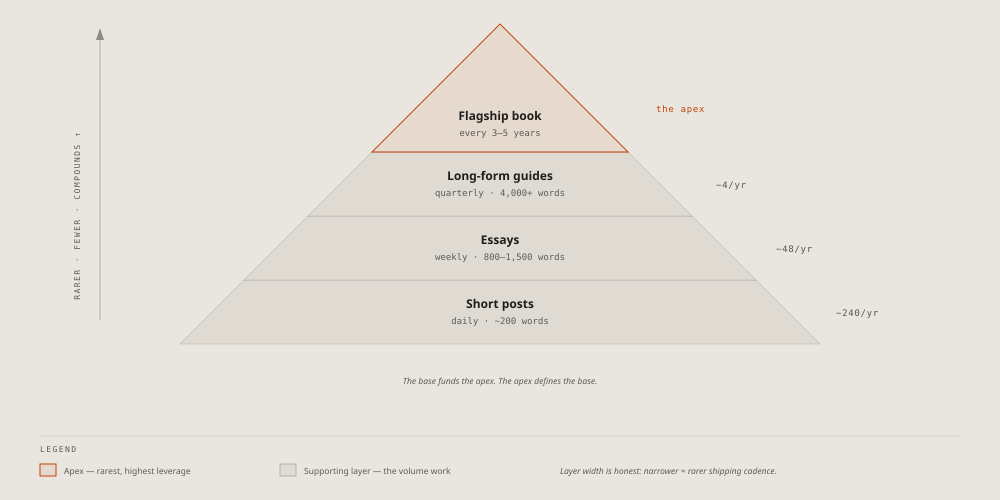

**Venn:** what two or three sets share; the overlap that matters named.
Credit: diagram-design's
[example-venn.html](https://github.com/cathrynlavery/diagram-design/blob/f6db0decea96de66b901331a0f79a8d4b147ebae/skills/diagram-design/assets/example-venn.html),
© 2025 Cathryn Lavery, MIT licence, recoloured.

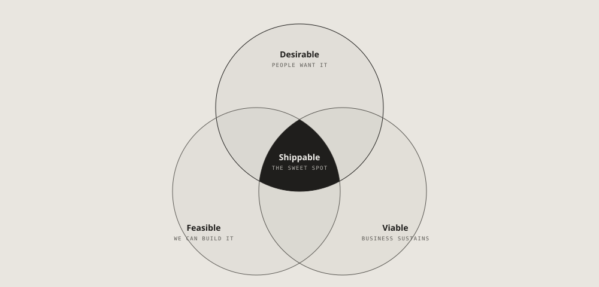

**Waterfall, a running total:** where it starts, each step up or down as
a floating bar, where it ends; not the [waterfall](waterfall.md) of one
request's time. Credit: diagram-design's
[example-waterfall.html](https://github.com/cathrynlavery/diagram-design/blob/f6db0decea96de66b901331a0f79a8d4b147ebae/skills/diagram-design/assets/example-waterfall.html),
© 2025 Cathryn Lavery, MIT licence, recoloured.

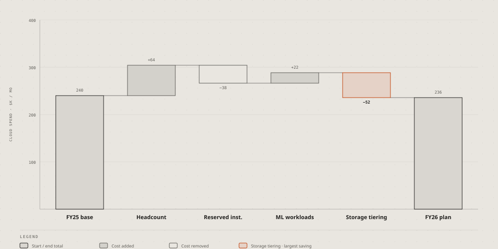

## For one trade

**High-level data stack:** a data platform end to end, from the sources
through ingestion, storage and query to the dashboards, on its cluster.
Credit: diagram-design's
[example-high-level.html](https://github.com/cathrynlavery/diagram-design/blob/f6db0decea96de66b901331a0f79a8d4b147ebae/skills/diagram-design/assets/example-high-level.html),
© 2025 Cathryn Lavery, MIT licence, recoloured.

**Medallion:** data kept in tiers by quality, from raw to aggregated,
each tier's tool, format and writer. Credit: diagram-design's
[example-medallion.html](https://github.com/cathrynlavery/diagram-design/blob/f6db0decea96de66b901331a0f79a8d4b147ebae/skills/diagram-design/assets/example-medallion.html),
© 2025 Cathryn Lavery, MIT licence, recoloured.

**Data platform integration:** the systems that feed a platform, the
consumers it serves, and the protocol on each link. Credit:
diagram-design's
[example-dp-integration.html](https://github.com/cathrynlavery/diagram-design/blob/f6db0decea96de66b901331a0f79a8d4b147ebae/skills/diagram-design/assets/example-dp-integration.html),
© 2025 Cathryn Lavery, MIT licence, recoloured.

**Data platform access:** roles as columns, components as rows, in each
cell what the role may do. Credit: diagram-design's
[example-dp-security-matrix.html](https://github.com/cathrynlavery/diagram-design/blob/f6db0decea96de66b901331a0f79a8d4b147ebae/skills/diagram-design/assets/example-dp-security-matrix.html),
© 2025 Cathryn Lavery, MIT licence, recoloured.

**IT current state:** today's systems by phase, the manual hand-offs
between them labelled, the pains marked; the before of a proposal.
Credit: diagram-design's
[example-it-state.html](https://github.com/cathrynlavery/diagram-design/blob/f6db0decea96de66b901331a0f79a8d4b147ebae/skills/diagram-design/assets/example-it-state.html),
© 2025 Cathryn Lavery, MIT licence, recoloured.

**SBGN:** a biological process in its standard notation, species as
rounded boxes, the processes between them as small squares, the place it
happens as a frame. Credit: diagram-design's
[example-sbgn.html](https://github.com/cathrynlavery/diagram-design/blob/f6db0decea96de66b901331a0f79a8d4b147ebae/skills/diagram-design/assets/example-sbgn.html),
© 2025 Cathryn Lavery, MIT licence, recoloured.

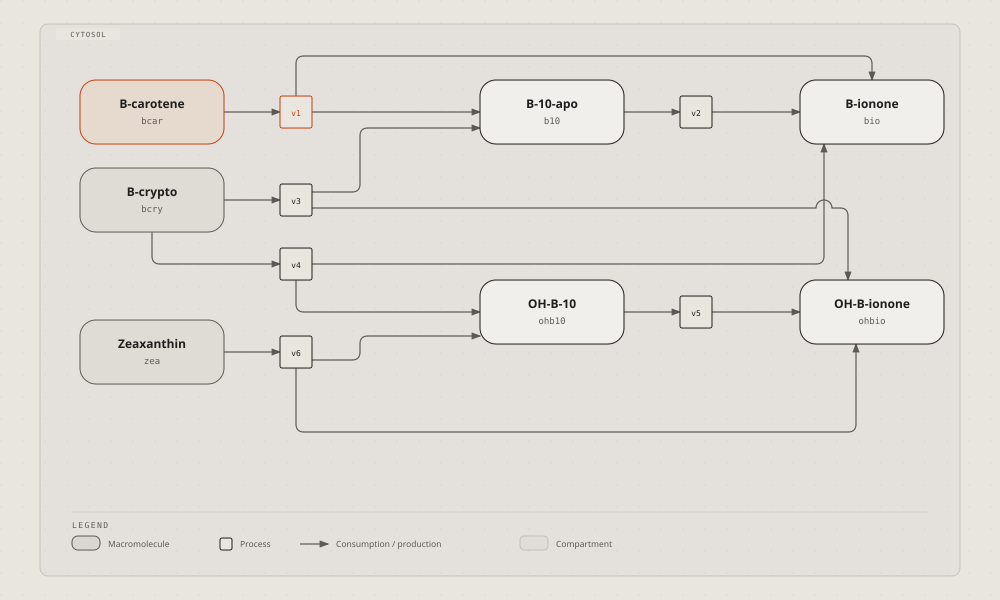

## References

- [diagram-design](https://github.com/cathrynlavery/diagram-design) by
  Cathryn Lavery, MIT licence, with its site
  [diagramdesign.dev](https://diagramdesign.dev): an agent skill that
  draws 50 kinds as hand-written SVG pages and checks them with two
  scripts. The 25 pictures on this page are its examples, taken at
  commit f6db0de and recoloured; its licence is kept beside them, in
  [diagrams/diagramdesign/LICENSE](https://github.com/vbarbarosh/rules/blob/main/diagrams/diagramdesign/LICENSE).
