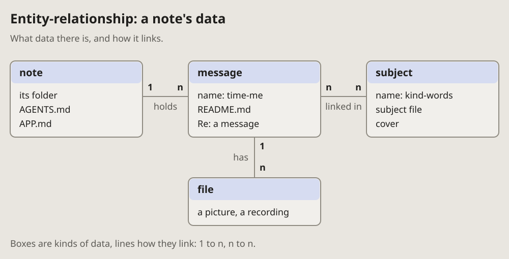

- Add all five. (2026-10-13, as the note of 16:29 quotes it)
- The new diagrams, I think, should go on the pages too, only in the same
  format as the other diagrams; and mind the arrows: take the ones the
  project uses. (16:33)

# Entity-relationship: what data there is and how it links

The kinds of data a system keeps, their main fields, and how many of one go
with one of another: 1 to n, n to n, marked on each line's ends.

## Fits when

- **The question is about data:** where something is kept, what points to
  what.
- **A change touches a link:** one becomes many, or a link goes away.
- **A newcomer reads the storage** before the code.

## Not when

- **Where the data lives** (which machine, which service): a
  [container sketch](containers.md).
- **What happens to one record over time:** a [state diagram](state.md).
- **Every field of every table:** keep the main ones; the schema is in the
  code.

## How it is drawn

1. **Entities:** a box per kind of data, its name in bold on a tinted band,
   its main fields under it.
2. **Links:** plain lines, no arrowheads, a verb under the line (holds, has,
   linked in).
3. **Their ends, crow's feet:** two short bars across the line where it is
   one, a three-pronged foot with a bar before it where it is many (one or
   more). **1** and **n** in bold beside them, for a reader who does not
   know the marks.
4. **Left to right** in the order a reader meets them; a child under its
   parent.
