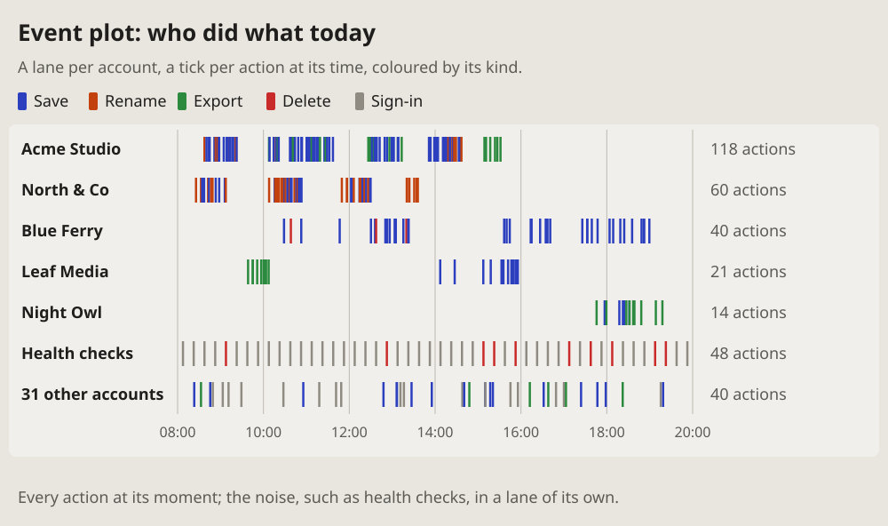

- What is this way of showing information called? (2026-10-19 19:40, of
  a picture of who did what today: a lane per account, a tick per action)
- Yes, let's add it too. (19:46)

# Event plot: who did what, when

Every event of many actors at its moment: a lane per actor, a tick per
event at its time, coloured by its kind. Also called a raster plot; told
as a timeline, a swimlane timeline.

## Fits when

- **Many actors, one log:** accounts, users, jobs or services, each with
  its events over the same hours.
- **When and by whom matter together:** bursts, quiet hours, who works
  when, what one actor did before another.
- **Every event counts:** a single delete in a lane of saves shows as one
  red tick.

## Not when

- **One actor's steps:** a [chronology](chronology.md), or a
  [timeline](timeline.md) when the gaps matter.
- **Only how many, by hour and day:** a [heatmap](heatmap.md) counts them
  in cells.
- **What each actor sends the others:** a
  [sequence diagram](sequence.md).

## How it is drawn

1. **Lanes:** one per actor, its name on the left; the busiest on top.
2. **The time:** one axis under the lanes, thin grey lines at even hours.
3. **Ticks:** a thin bar per event at its time, coloured by its kind, a
   legend of the kinds on top.
4. **Totals:** at the end of each lane, how many events it holds.
5. **Noise:** health checks, bots, staff in a lane of their own, under
   the rest; the many quiet actors folded into one lane, "31 other
   accounts".
