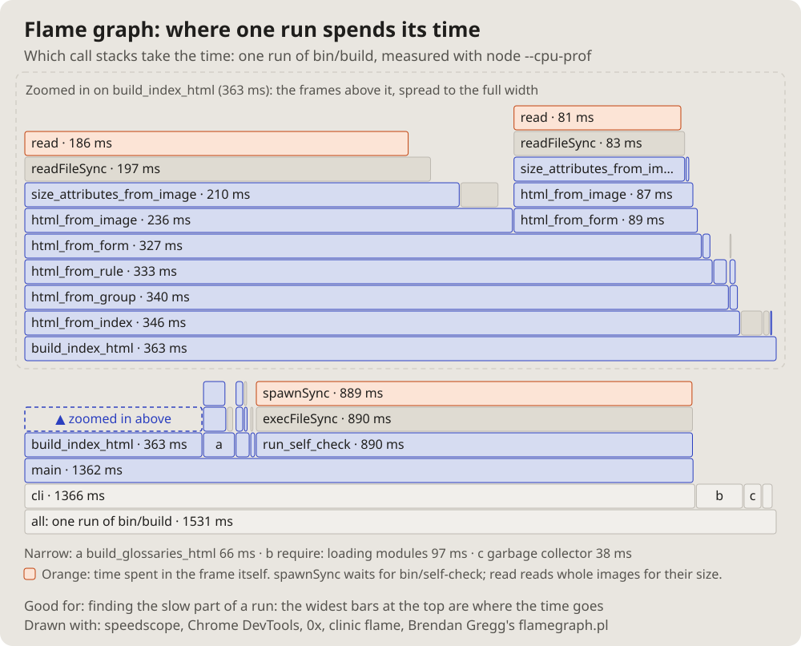

- I will also need a diagram of the topology of, say, some program, some
  script; how can that be done. (2026-10-14 18:15)
- Let us add these pictures to the documentation. Which get used is not
  clear yet, but let them be; we will see. (19:01)

# Flame graph: where one run spends its time

One measured run: each call stack a column of bars, the caller under the
callee, each bar as wide as its share of the time. The widest bars at the
top are where the time goes.

## Fits when

- **"Why is it slow?":** the time of a run by function, measured.
- **Before and after a speed fix:** the same bar, narrower.

## Not when

- **The structure, not the time:** a [call graph](callgraph.md).
- **Time across services:** a [sequence diagram](sequence.md) of a trace.

## How it is drawn

1. **Bars:** bottom-up, the whole run at the bottom, widths to one scale,
   the name and the milliseconds in each.
2. **Too narrow:** a letter in the bar, its name in a key; a narrow part
   that matters zoomed above.
3. **Self time:** the bars that spend it themselves marked in orange.
