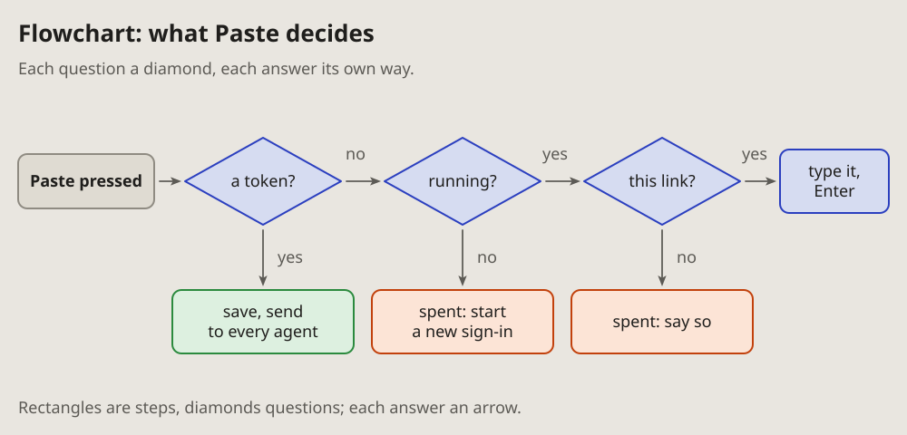

- Add all five. (2026-10-13, as the note of 16:29 quotes it)
- The new diagrams, I think, should go on the pages too, only in the same
  format as the other diagrams; and mind the arrows: take the ones the
  project uses. (16:33)

# Flowchart: what is decided where

The decisions one action goes through, in order: each question a diamond,
each answer its own arrow, each outcome a box.

## Fits when

- **One action branches:** a click, a request or a job that does different
  things depending on what it finds.
- **The question is which way it went,** and why: an outcome nobody
  expected.
- **A rule has cases,** and every case must be seen at once.

## Not when

- **A thing lives through states** and comes back to them: a
  [state diagram](state.md).
- **Several parts take turns:** a [sequence diagram](sequence.md).
- **More than about six questions:** split it, or say it as a table of
  cases.

## How it is drawn

1. **Steps:** rectangles; the one that starts it darker.
2. **Questions:** diamonds, a few words ending in a question mark, the
   words inside the diamond.
3. **Answers:** the project's arrows, one per answer, each labelled (yes,
   no, or the value).
4. **Outcomes:** boxes coloured by what they mean: green done, orange
   refused or spent, blue the way on.
5. **Left to right** for the main way, **down** for the answers that leave
   it.
