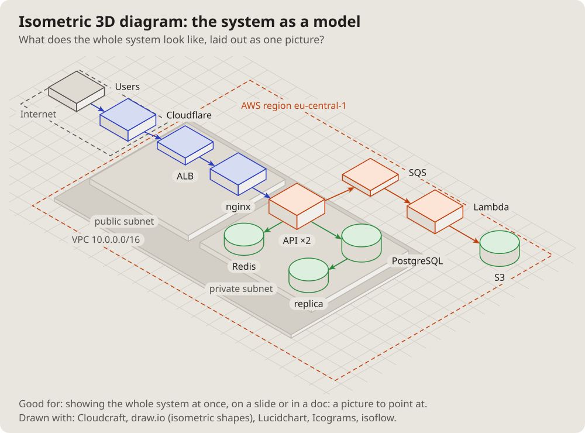

- I am more interested in the topology of computer systems: some complex
  architecture with queues, Cloudflare, S3, Lambda, proxies, load
  balancers, databases, all of that. (2026-10-14 18:13)
- Let us add these pictures to the documentation. Which get used is not
  clear yet, but let them be; we will see. (19:01)

# Isometric diagram: the system as a model

The same parts as blocks on an isometric floor, the networks as raised
platforms, the main paths along the grid: a picture to point at on a
slide, read before any word.

## Fits when

- **A slide or a talk:** the whole system at once, for people who will
  not read a diagram's notation.
- **Groups matter more than links:** what sits together on which
  platform.

## Not when

- **Exact links, ports or order:** any other kind says it better; an
  isometric picture hides lines behind blocks.
- **The picture will change often:** the layout is slow to redraw.

## How it is drawn

1. **The floor:** a faint isometric grid; places as dashed outlines on it.
2. **Platforms:** a raised slab per network, its name on a pill.
3. **Parts:** blocks for services, cylinders for stores, a name on a pill.
4. **Paths:** only the main ones, along the grid, coloured by kind.
