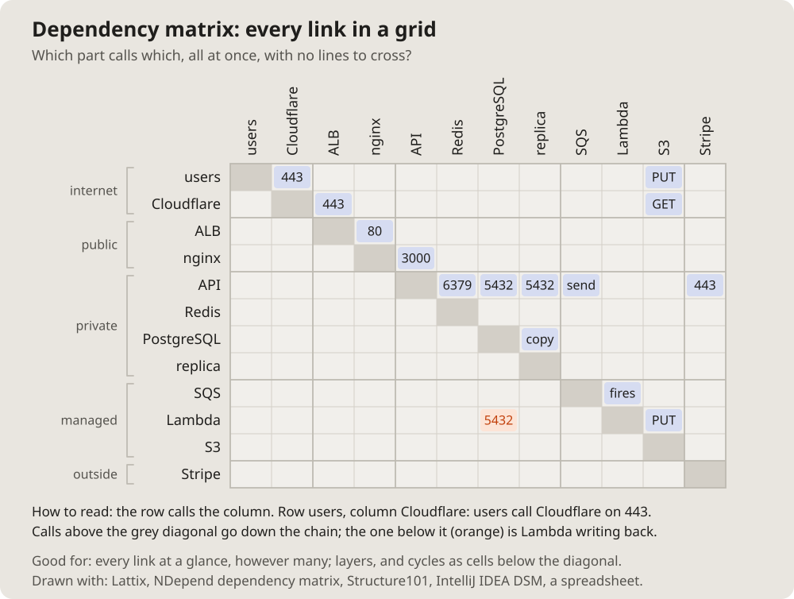

- I am more interested in the topology of computer systems: some complex
  architecture with queues, Cloudflare, S3, Lambda, proxies, load
  balancers, databases, all of that. (2026-10-14 18:13)
- Let us add these pictures to the documentation. Which get used is not
  clear yet, but let them be; we will see. (19:01)

# Dependency matrix: every link in a grid

The parts as rows and the same parts as columns; a filled cell where the
row calls the column. Every link at once, however many, with no lines to
cross.

## Fits when

- **Many parts:** where a graph turns into a hairball.
- **Layers and cycles:** with the parts in order, a call below the
  diagonal goes against the layers.

## Not when

- **A few parts:** a [layered diagram](tiers.md) reads faster.
- **The order of the calls:** a [sequence diagram](sequence.md).

## How it is drawn

1. **Rows and columns:** the same parts in the same order, the column
   names turned upright, groups bracketed on the left.
2. **Cells:** filled where the row calls the column, with a port or a verb
   when it fits.
3. **Reading:** a line under it says how ("the row calls the column").
