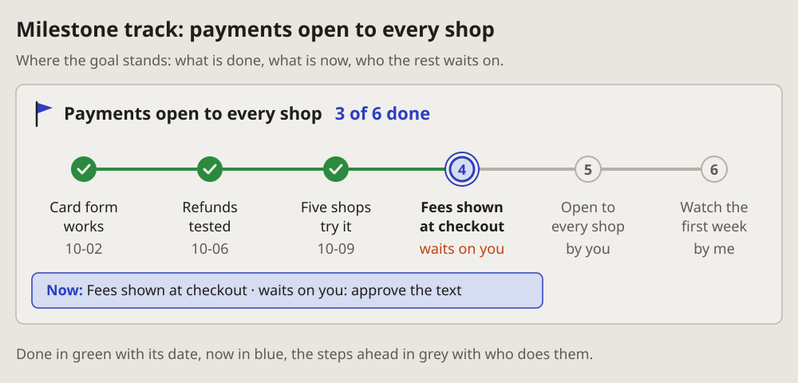

- Add all of them, only make them anonymous: nothing about the company or
  anything personal. (2026-10-14 23:56, of the visual-lang drafts)

# Milestone track: where a goal stands

One goal and its steps on a line, left to right: the steps done, the step
now, the steps ahead, and who each one waits on.

## Fits when

- **One goal, a few steps:** four to seven, each done or not.
- **The question is what is next** and who it waits on: the reader or
  the agent.
- **The same track is shown again later,** and the reader sees how far
  it moved.

## Not when

- **What happened when** matters, not what is left: a
  [timeline](timeline.md).
- **A thing's states** and what moves it between them: a
  [state diagram](state.md).
- **Many parts at once,** each with its own state: a
  [status dashboard](dashboard.md).

## How it is drawn

1. **The band:** one framed panel; a flag, the goal's name in bold and
   how many steps are done, in blue, beside it.
2. **The steps:** dots on one line, left to right. A done step is green
   with a tick, a green line up to the step now; the step now is a blue
   ring with its number; the steps ahead are grey, numbered, on a grey
   line.
3. **Under each dot:** its name in a word or two, and under that its
   date when done, or who it waits on: "waits on you" in amber for the
   step now, "by you" or "by me" for the steps ahead.
4. **Now:** a blue box under the line names the step now and what it
   waits on, in one sentence.
