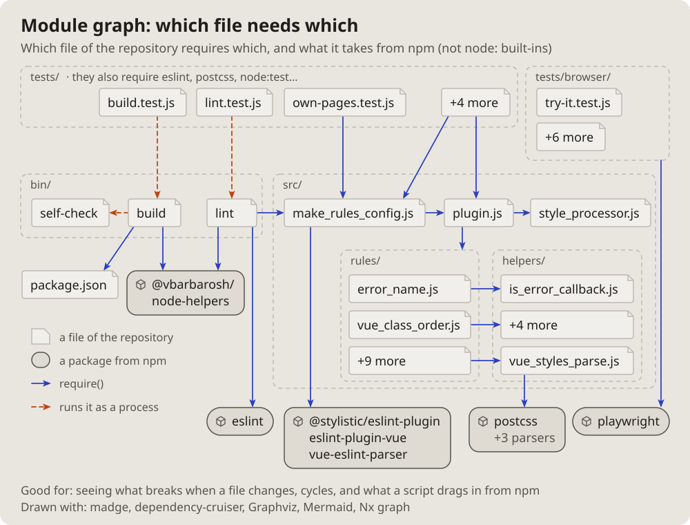

- I will also need a diagram of the topology of, say, some program, some
  script; how can that be done. (2026-10-14 18:15)
- Let us add these pictures to the documentation. Which get used is not
  clear yet, but let them be; we will see. (19:01)

# Module graph: which file needs which

The files of a project as boxes in their folders, an arrow from each file
to each one it requires, the packages from outside in their own shape.

## Fits when

- **What breaks when a file changes:** everything that points at it.
- **Cycles and layers:** an arrow that goes back up.
- **What a script drags in** from outside.

## Not when

- **Functions inside one file:** a [call graph](callgraph.md).
- **Hundreds of files:** a [dependency matrix](matrix.md).

## How it is drawn

1. **Folders:** dashed frames named at the top left.
2. **Files and packages:** a box with a folded corner for a file, a
   rounded one with a cube for a package.
3. **Arrows:** blue for a require, dashed orange for running it as a
   process; "+N more" for the rest.
