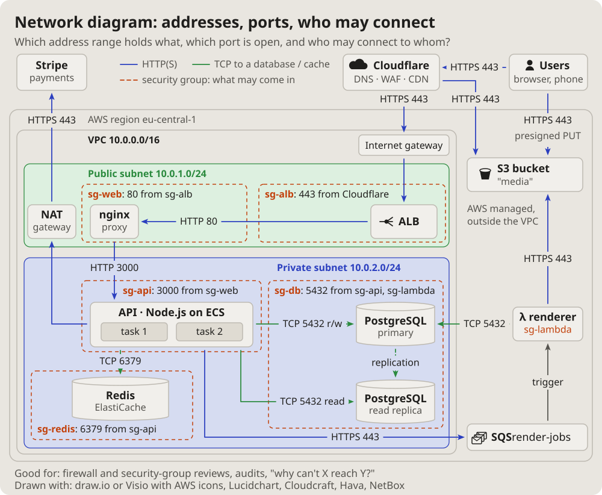

- I am more interested in the topology of computer systems: some complex
  architecture with queues, Cloudflare, S3, Lambda, proxies, load
  balancers, databases, all of that. (2026-10-14 18:13)
- Let us add these pictures to the documentation. Which get used is not
  clear yet, but let them be; we will see. (19:01)

# Network diagram: addresses, ports, who may connect

The network engineer's view: address ranges as bands, the gateways at
their borders, a security group around what it guards with what it lets
in, every link with its protocol and port.

## Fits when

- **"Why can't X reach Y?":** a port, a rule or a subnet in the way.
- **A firewall or security-group review:** what is open, from where.
- **Addresses matter:** ranges, gateways, what has a public address.

## Not when

- **What each part does:** a [C4 container diagram](containers.md).
- **What data crosses where, for a threat model:** a
  [data flow diagram](dataflow.md).

## How it is drawn

1. **Bands:** each subnet a filled band with its name and range.
2. **Guards:** a security group a dashed outline around what it guards,
   its rule on the outline ("5432 from sg-api").
3. **Links:** every arrow with its protocol and port on a pill.
