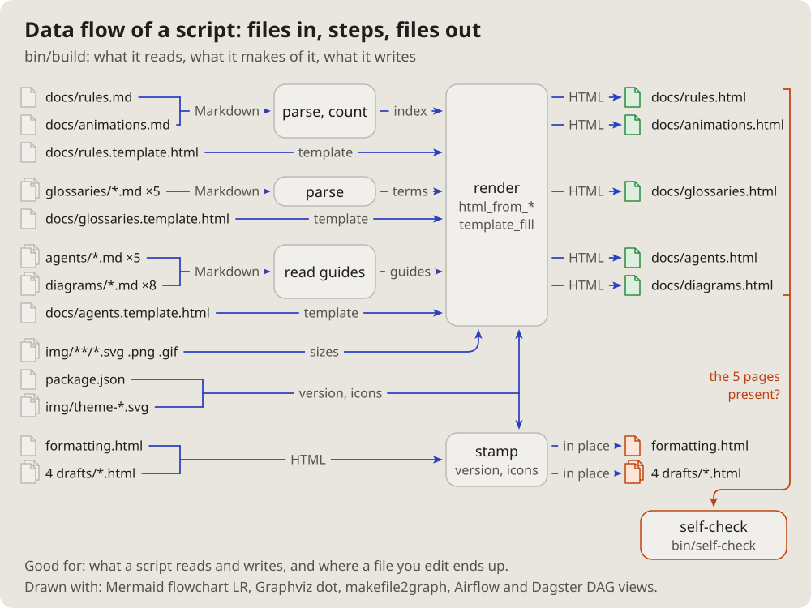

- I will also need a diagram of the topology of, say, some program, some
  script; how can that be done. (2026-10-14 18:15)
- Let us add these pictures to the documentation. Which get used is not
  clear yet, but let them be; we will see. (19:01)

# Data flow of a script: files in, steps, files out

What a script reads on the left, the steps it makes of it in the middle,
what it writes on the right; each arrow named by what passes along it.

## Fits when

- **"Where does my edit end up?":** from a source file to the page.
- **A build, an import, an export:** a script whose job is files.

## Not when

- **The functions inside:** a [call graph](callgraph.md).
- **A system of services:** a [layered diagram](tiers.md).

## How it is drawn

1. **Files:** a page icon and the path; inputs left, outputs right, the
   ones rewritten in place in their own colour.
2. **Steps:** rounded boxes in the middle.
3. **Arrows:** named by what passes ("Markdown", "index", "HTML").
