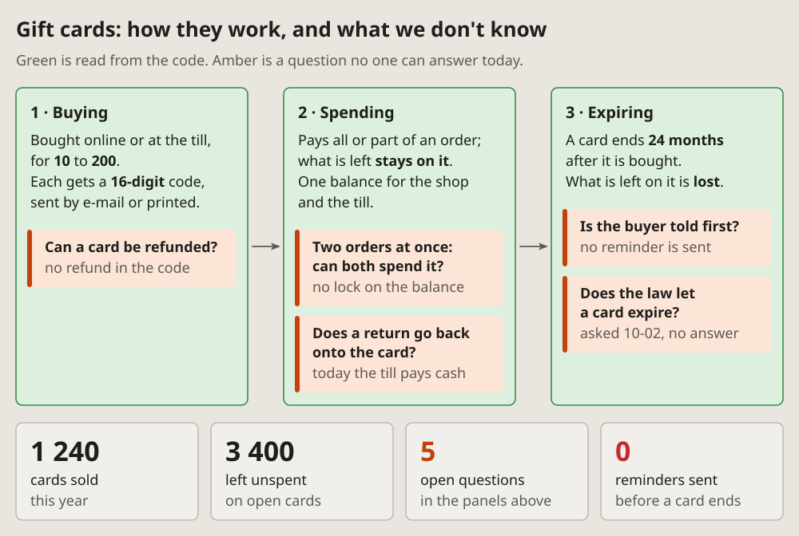

- Add all of them, only make them anonymous: nothing about the company or
  anything personal. (2026-10-14 23:56, of the visual-lang drafts)

# Known and open questions: how it works, and the gaps

How something works, stage by stage, with the facts read from the code
and the questions no one can answer yet, each where it arises. A panel per
stage, left to right; the questions inside the panel they belong to; a row
of big numbers under them.

## Fits when

- **Someone asks how a thing works,** and part of the answer is "no one
  knows yet".
- **The facts and the gaps must be told apart:** what the code says,
  beside what a person still has to decide or find out.
- **A meeting needs its questions:** each one shown where it bites, not
  in a list at the end.

## Not when

- **What is decided where,** step by step: a
  [flowchart](flowchart.md).
- **A thing's states** and what moves it between them: a
  [state diagram](state.md).
- **Where many parts stand:** a [status dashboard](dashboard.md).

## How it is drawn

1. **The title says both halves:** "how it works, and what we don't
   know", and the line under it says what green and amber mean.
2. **Stages:** a green panel each, numbered "1 · Buying", left to right,
   an arrow between them; a few short lines of facts, the key figures in
   bold.
3. **Questions:** an amber note inside the panel where the question
   arises, a thick amber bar on its left; the question in bold, and in
   grey what is known so far.
4. **Big numbers:** a row under the panels, each a number and two lines
   of what it counts; amber or red when it stands for a gap.
5. **Facts only in green:** a line in a green panel is read from the
   code or a log; a guess is a question, and goes in amber.
