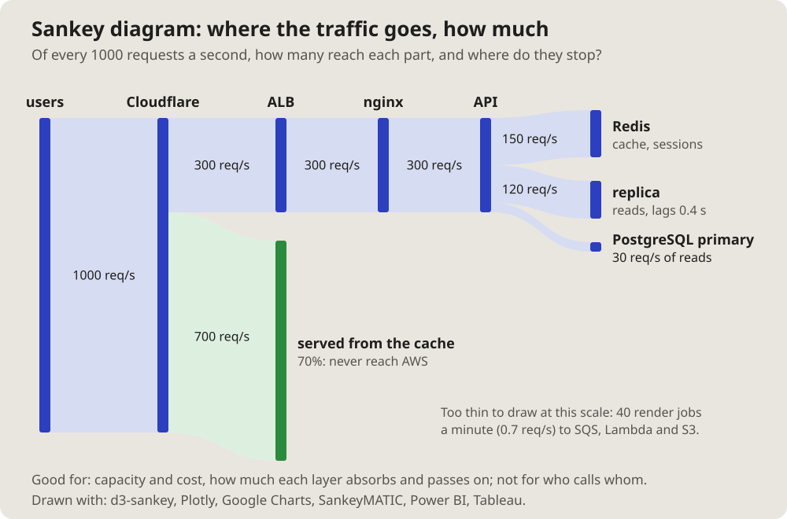

- I am more interested in the topology of computer systems: some complex
  architecture with queues, Cloudflare, S3, Lambda, proxies, load
  balancers, databases, all of that. (2026-10-14 18:13)
- Let us add these pictures to the documentation. Which get used is not
  clear yet, but let them be; we will see. (19:01)

# Sankey diagram: where the traffic goes, how much

Traffic as bands that split and end, each as wide as its share: what a
cache absorbs, what reaches each part behind it.

## Fits when

- **Capacity and cost:** how much each layer absorbs and passes on.
- **A cache's worth:** the share that never reaches the origin.

## Not when

- **Who calls whom:** a [service map](servicemap.md) or a
  [layered diagram](tiers.md).
- **Flows too small to see** beside big ones: say them in a line under it.

## How it is drawn

1. **Columns:** a thin bar per part, its name above.
2. **Bands:** from bar to bar, widths to one scale, each with its number.
3. **Ends:** what stops early ends at its own bar, in its own colour.
