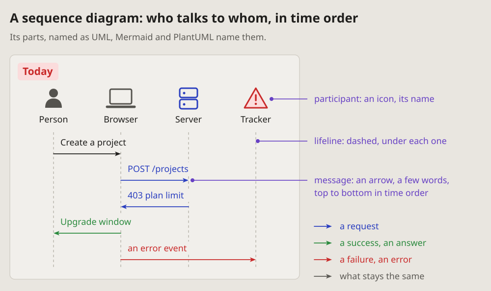
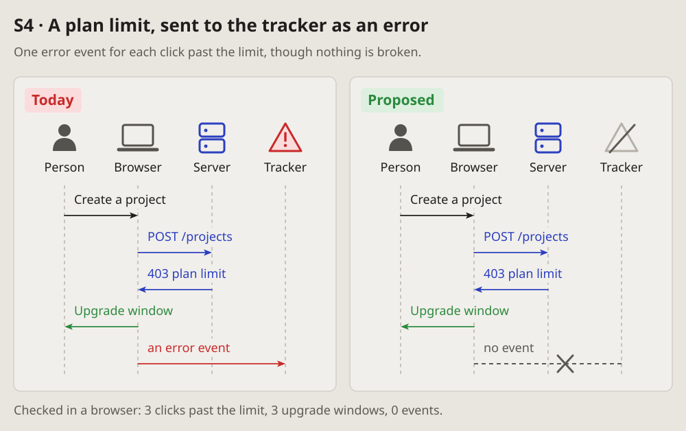
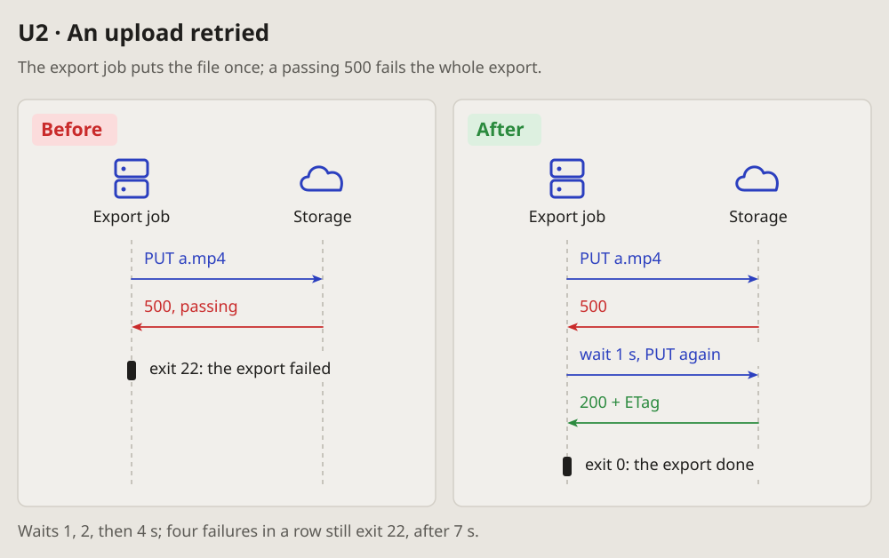
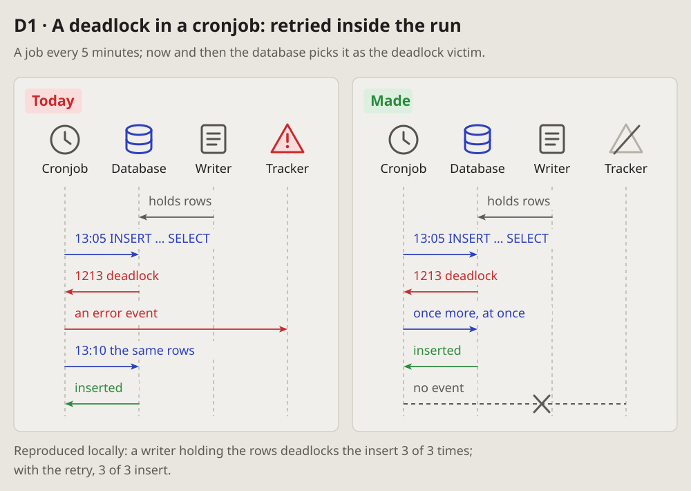
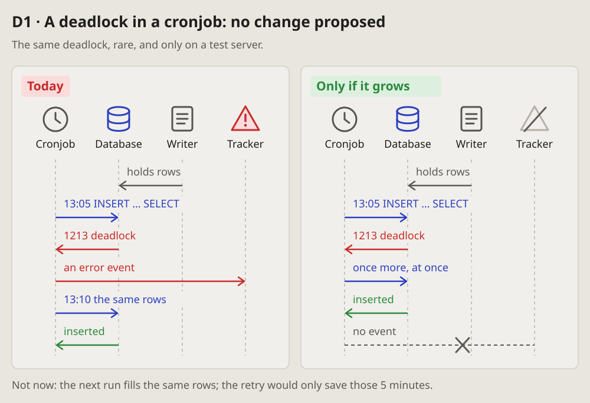
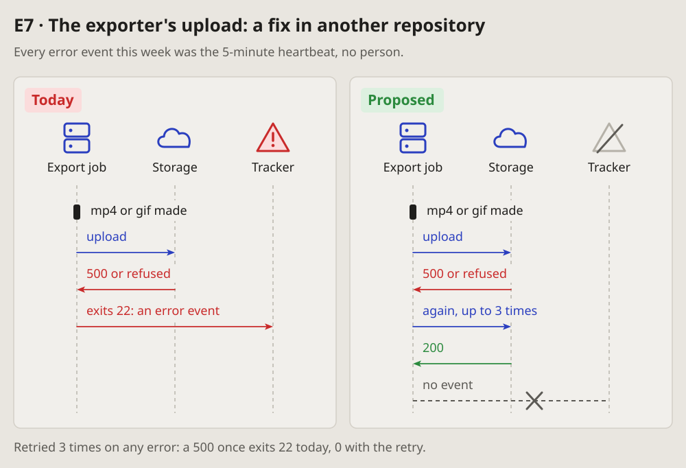
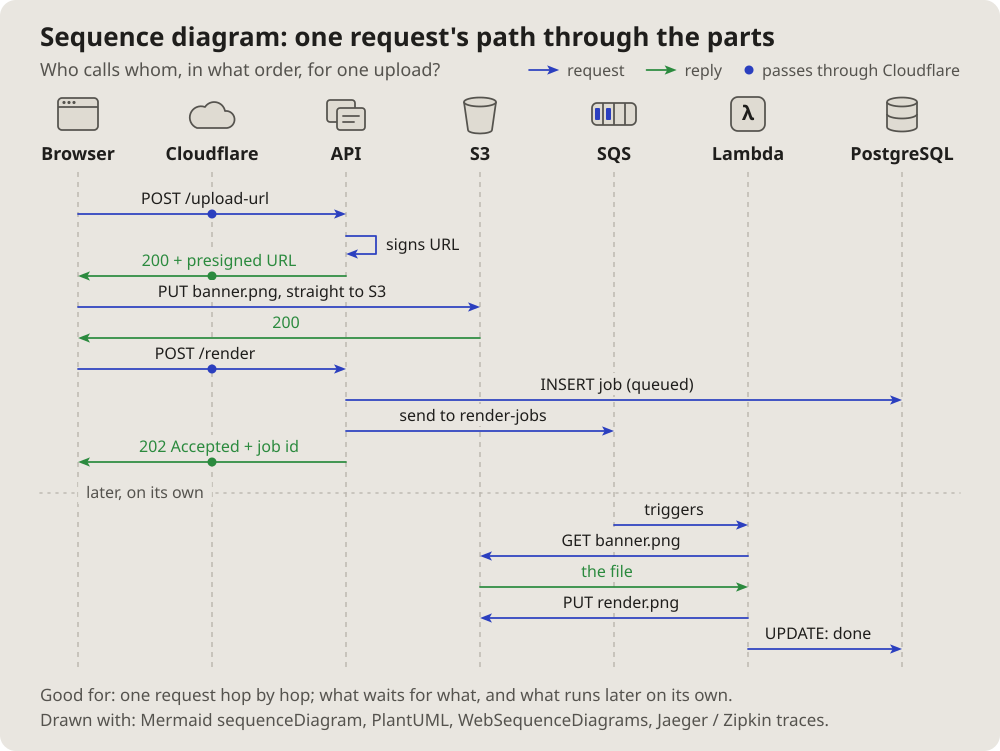

- Pictures that are clear to me; I'd like agents to make pictures of this
  kind in their messages: it makes them easier to understand. And especially
  the icons. (2026-10-13 15:29)
- It makes sense to make one diagrams page, where we add diagrams, describe
  what they are, when they fit and when they do not: a visual language of
  sorts. This is a good example of a diagram for the course of events.
  (15:50)

# Sequence diagram: who talks to whom

The course of events: the parts of a system as columns, what they send each
other as arrows, top to bottom in time order. A request, a failure, a retry or
a fix reads in one look, and today beside proposed shows only the change.

## Fits when

- **Parts pass something along:** a person, a browser, a server, a database,
  a job, an outside service.
- **The order matters:** a failure, a retry, a timeout, a race; what happens
  where, and after what.
- **A fix changes the course:** a step added, an event dropped, a call moved.
  Today beside proposed.

## Not when

- **One part alone,** nothing passed between: its states are a
  [state diagram](state.md), its decisions a [flowchart](flowchart.md), its
  look a screenshot.
- **The order does not matter,** only where the parts run or how the data
  links: a [container sketch](containers.md) or an
  [entity-relationship diagram](entities.md).
- **The times matter more than who:** a [timeline](timeline.md).
- **Too many at once:** more than five participants or ten messages. Split
  it in two, or say it in a table.
- **A change the author sees on screen:** screenshots before and after say it
  better.

## How it is drawn

1. **Participants:** one column each, a plain icon above a short name. A
   person, a laptop or browser, a server, a database cylinder, a clock for a
   cronjob, a page for another writer or a file, a cloud for an outside
   service, a warning triangle for an error tracker. The icons carry most of
   the reading; the names stay short.
2. **Lifelines:** a dashed vertical line under each participant.
3. **Messages:** arrows between lifelines, top to bottom in time order, each
   with a few words. A request blue, a failure or an error red, a success or
   an answer green, what stays the same grey. A note on a step sits on its
   arrow: `13:05 INSERT … SELECT`, `403 plan limit`.
4. **Today beside proposed** (or before beside after, today beside made): two
   framed panels, tagged, the same participants in the same order, so only
   the change differs. The change is drawn, not described: an event crossed
   out, a step added, a participant greyed.
5. **Around it:** a title line with the item's id and what it is, one line of
   context under it (where, how often), one line of proof under the panels.
6. **In the app's colours,** and drawn for the width it is shown at: its words
   no smaller than the text around it.

## Examples

