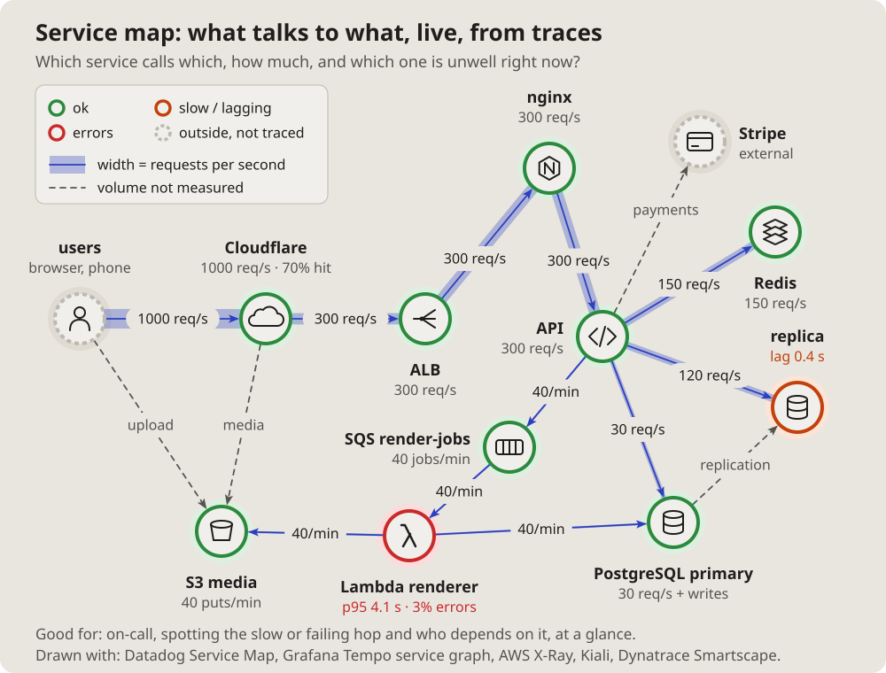

- I am more interested in the topology of computer systems: some complex
  architecture with queues, Cloudflare, S3, Lambda, proxies, load
  balancers, databases, all of that. (2026-10-14 18:13)
- Let us add these pictures to the documentation. Which get used is not
  clear yet, but let them be; we will see. (19:01)

# Service map: what talks to what, live

What a tracing tool draws from real traffic: each service a circle with a
ring for its health, each link as thick as its traffic, the numbers on the
links. The unwell one stands out at a glance.

## Fits when

- **On call:** which hop is slow or failing, and who depends on it.
- **Traffic matters:** where the requests go, how many.
- **The real system,** as measured, not as designed.

## Not when

- **The design, before it runs:** a
  [C4 container diagram](containers.md).
- **How much of the traffic stops where:** a [Sankey diagram](sankey.md).

## How it is drawn

1. **Services:** circles laid out freely, an icon inside, the name and one
   number under it.
2. **Health:** the ring green, orange when slow, red when failing, dashed
   grey for what is not traced.
3. **Links:** thickness by traffic, "N req/s" on a pill; a legend.
