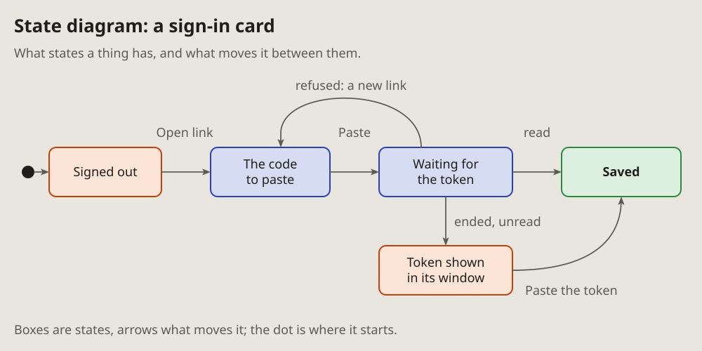

- Add all five. (2026-10-13, as the note of 16:29 quotes it)
- The new diagrams, I think, should go on the pages too, only in the same
  format as the other diagrams; and mind the arrows: take the ones the
  project uses. (16:33)

# State diagram: what moves a thing between its states

The states a thing has and what moves it from one to the next: a card's
steps, a message's life, a job's run. Each state is a box; each arrow says
what moves it.

## Fits when

- **A thing has a few states,** and the question is how it gets from one to
  another, or why it stays in one.
- **A state can be reached by more than one way,** or left by a way that
  goes back.
- **A bug is a wrong state:** stuck, skipped, or reached from where it
  should not be.

## Not when

- **The order of calls between parts** is the question: that is a
  [sequence diagram](sequence.md).
- **One decision with its answers,** no lasting state: a
  [flowchart](flowchart.md).
- **More than about eight states:** draw the part that matters, and say the
  rest.

## How it is drawn

1. **States:** rounded boxes, a short name each. Coloured by what they mean:
   blue a step on the way, green the end that is wanted, orange one that
   needs a look.
2. **Transitions:** the project's arrows, grey, each with the few words
   that move it (a click, an answer, a timeout).
3. **The start:** a filled dot with an arrow into the first state.
4. **Around it:** a title with the thing's name, one line of context, one
   line under it saying how to read it.
