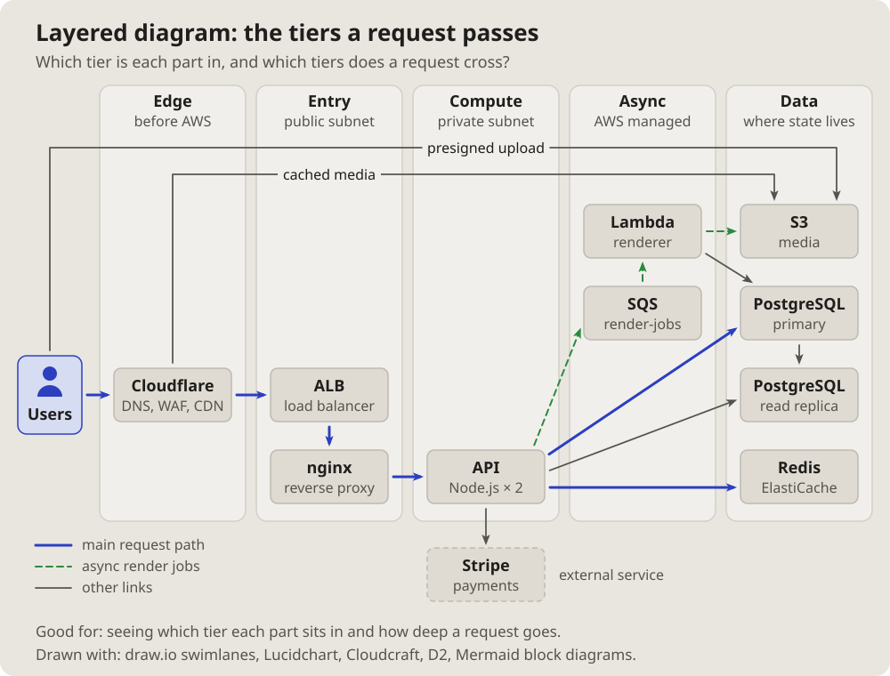

- I am more interested in the topology of computer systems: some complex
  architecture with queues, Cloudflare, S3, Lambda, proxies, load
  balancers, databases, all of that. (2026-10-14 18:13)
- Let us add these pictures to the documentation. Which get used is not
  clear yet, but let them be; we will see. (19:01)

# Layered diagram: the tiers a request passes

The parts in columns by tier, left to right in the order a request meets
them: the edge, the entry, the compute, the background work, the data.
The main path bold, the side paths in their own style.

## Fits when

- **How deep a request goes:** which tiers it crosses before an answer.
- **Where a part belongs:** a new service placed in its tier, or one in
  the wrong one.
- **A caching or scaling talk:** what each tier absorbs.

## Not when

- **Where things run, in which network:** a
  [cloud architecture diagram](cloud.md).
- **Many links between many parts:** a [dependency matrix](matrix.md).

## How it is drawn

1. **Tiers:** columns with a name and a line under it, left to right.
2. **Parts:** boxes in their tier; outside parties outside the columns.
3. **Paths:** the main one bold blue, the background one dashed green, the
   rest thin grey; a key under the drawing.
