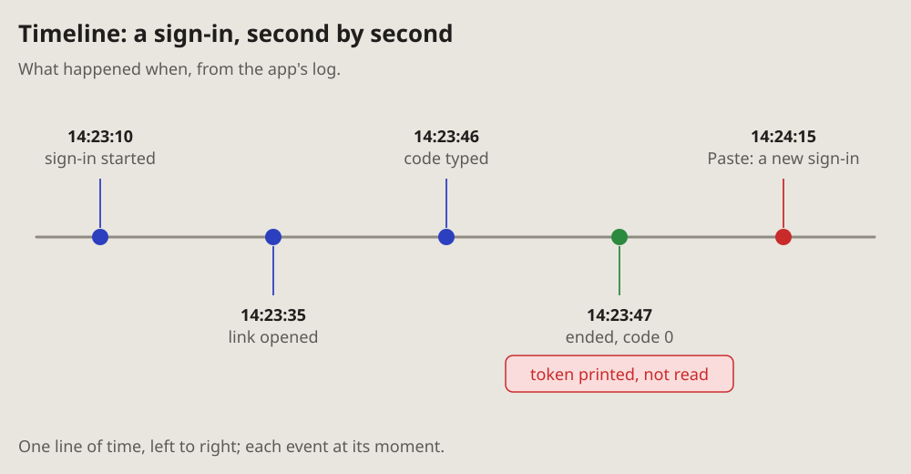

- Add all five. (2026-10-13, as the note of 16:29 quotes it)
- The new diagrams, I think, should go on the pages too, only in the same
  format as the other diagrams; and mind the arrows: take the ones the
  project uses. (16:33)

# Timeline: what happened when

Events at their moments, from a log: one line of time, left to right, each
event a dot with its time and a few words.

## Fits when

- **A log tells it:** times matter, and the gaps between them.
- **The question is what came before what,** or what happened while
  something else waited.
- **One event went wrong** among others that did not.

## Not when

- **Who sent what to whom** matters more than when: a
  [sequence diagram](sequence.md).
- **The times do not matter,** only the order of states: a
  [state diagram](state.md).
- **Hundreds of events:** pick the few that tell it, and say how many were
  left out.

## How it is drawn

1. **The line of time:** one grey line, left to right.
2. **Events:** a dot on the line, a stem to its label, the time in bold
   above a few words. The labels go above and below in turn, so close
   events do not collide.
3. **Colours:** blue for what went as it should, green for an end that is
   wanted, red for what went wrong.
4. **What went wrong** gets a note of its own, in red, under its event.
