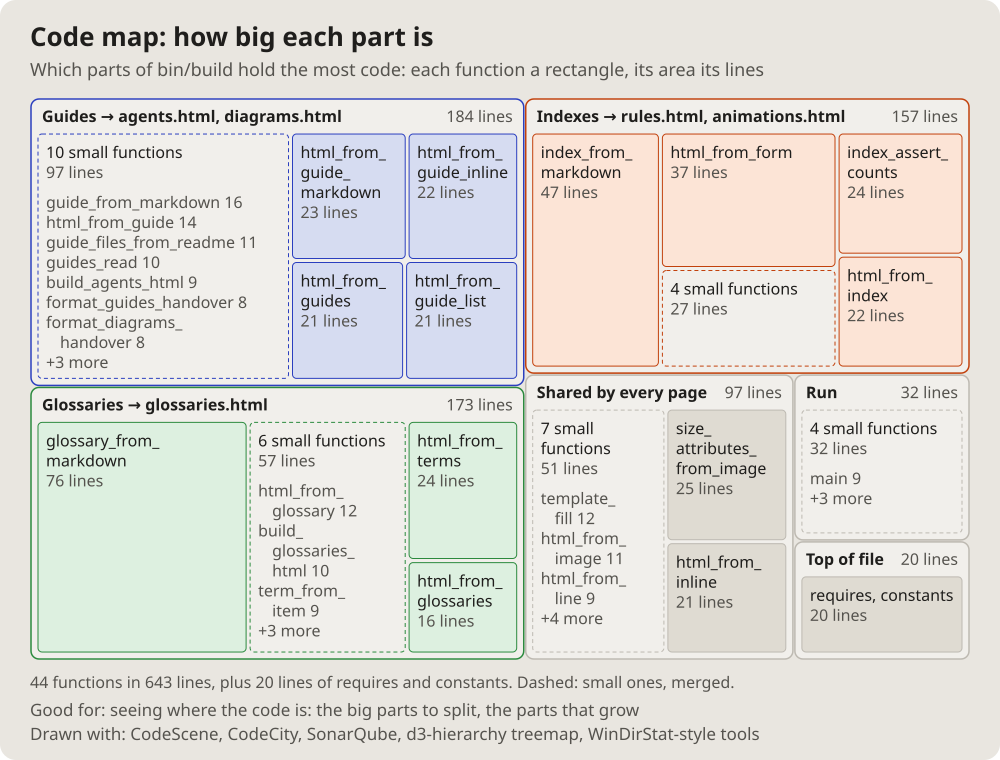

- I will also need a diagram of the topology of, say, some program, some
  script; how can that be done. (2026-10-14 18:15)
- Let us add these pictures to the documentation. Which get used is not
  clear yet, but let them be; we will see. (19:01)

# Code map: how big each part is

A treemap of the code: each function a rectangle, its area its lines,
grouped by the part of the program it belongs to.

## Fits when

- **Where the code is:** the big parts to split, the parts that grow.
- **A first look at a large file or project.**

## Not when

- **Who calls whom:** a [call graph](callgraph.md).
- **Where the time goes:** a [flame graph](flame.md); size is not cost.

## How it is drawn

1. **Groups:** a frame per part, its name and its lines in the header.
2. **Rectangles:** one per function, area by lines, the name and the count
   when they fit.
3. **The small ones:** merged into a dashed "N small functions" box.
