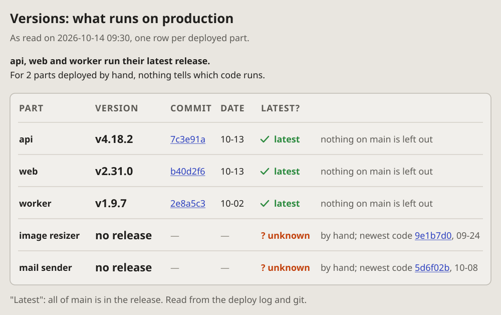

- Add all of them, only make them anonymous: nothing about the company
  or anything personal. (2026-10-14 23:56, of the visual-lang drafts)

# Versions: which version runs where

A table of what is deployed: one row per part, its version, its commit
and its date, and whether it is the latest. A verdict in a sentence on
top, what "latest" means at the bottom.

## Fits when

- **The question is what runs now:** before a release, after an
  incident, when a fix should already be live.
- **Some parts are deployed by hand,** and the reader must see which of
  them no one can vouch for.
- **Many parts, each with its own version,** too many to keep in mind.

## Not when

- **How the parts talk to each other:** a
  [containers diagram](containers.md).
- **Where the parts run:** a [cloud diagram](cloud.md).
- **How healthy they are now:** a [service map](servicemap.md) or a
  [status dashboard](dashboard.md).

## How it is drawn

1. **The time it was read,** under the title: a version table is true
   only for the moment it was taken.
2. **The verdict first:** one sentence, its first half in bold, says
   what the table shows before the reader reads a row.
3. **A row per deployed part:** its name in bold, the version big and
   bold, the commit in the look of a link, the date.
4. **Latest or not:** a green tick and "latest", or an amber
   "? unknown"; never a guess. A grey note says why: "nothing on main is
   left out", or how it was deployed and the newest code there is.
5. **What "latest" means,** in a line under the table, and where it was
   read from.
6. **The reader on top, agents below:** the summary first; the
   sources of every version, the files and logs it was read from, go
   under a line, in a part of their own for agents.
