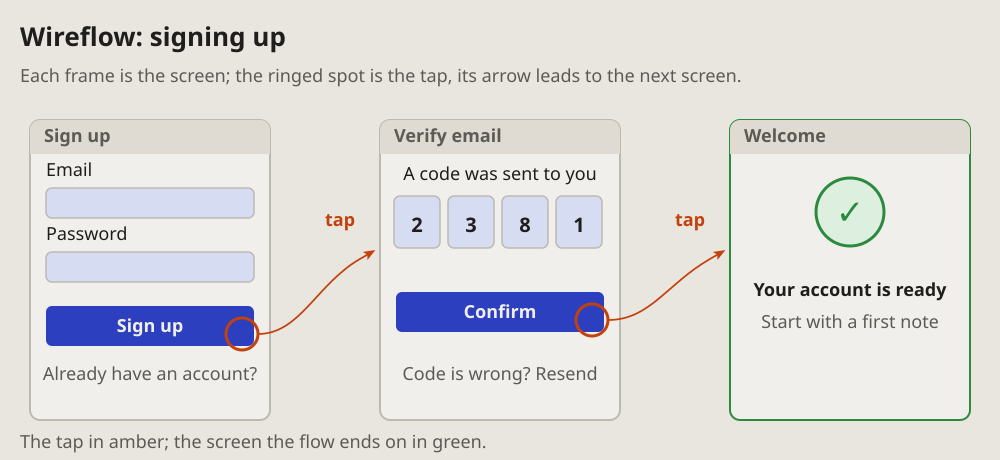
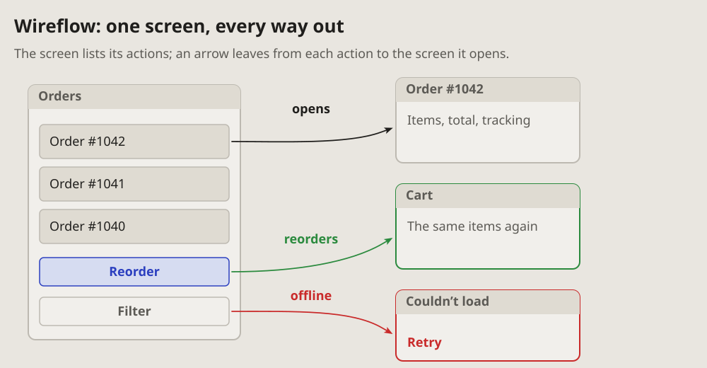

- I like this kind of diagram, the screens with arrows. Add these
  references somewhere, and look at what can be done with them: they
  are probably a category of their own, and a couple of good examples
  go there. (2026-11-17 19:53, by voice, with a Balsamiq wireflow of
  Sign up and Verify email)

# Wireflow: the screens a user passes

The screens themselves, drawn small, with an arrow from the spot that is
tapped to the screen it opens. Also called a screen flow. It is a
[flowchart](flowchart.md) with the real screens in the boxes: the reader
sees what the user sees at each step, not a name for it.

One screen with every way out of it: each action on the screen has its
own arrow, to the screen it opens.

## Fits when

- **A way through an app:** sign-up, checkout, onboarding: what the user
  sees first, what they tap, what comes next.
- **The question is what the next screen is,** and what is on it, for a
  step that words would only name.
- **A screen has several ways out,** one of them a failure: each gets its
  own arrow and its own screen.

## Not when

- **No screens yet, only steps and decisions:** a
  [flowchart](flowchart.md).
- **Several actors share the work:** [swimlanes](swimlanes.md).
- **What changes inside one screen:** an [annotated screen](screen.md).
- **What the user feels along the way:** a journey map, which this page
  does not draw.

## How it is drawn

1. **A frame per screen,** with its title in a bar on top and only the
   parts that matter: a field, a button, a line of text. Grey for the
   rest, as in the [annotated screen](screen.md).
2. **The tap:** an amber ring on the button or the row that is tapped.
3. **The arrow:** the project's arrows, from the ring to the screen it
   opens, a word on it when the action is not plain (offline, tap).
4. **Colour on the screens:** the end of the flow framed in green, a
   failure framed in red.
5. **Left to right** for the main way, **down** for the ways out; one
   flow to a picture, up to about five screens.
6. **Several ways out of one screen:** list its actions on it and take
   an arrow from each, as in the second picture.

## Examples worth looking at

- [Balsamiq's wireflows guide](https://balsamiq.com/blog/wireflows/):
  hand-drawn screens, a click marked by a hand, a curved arrow to the
  next screen.
- [Signal v Noise, a shorthand for UI flows](https://signalvnoise.com/posts/1926-a-shorthand-for-designing-ui-flows):
  a screen as a box with its actions listed under it, an arrow from each
  action to the screen it opens.
- [Adapty's flow screen map](https://adapty.io/docs/flow-screen-map):
  branches that split and rejoin, the paths of an onboarding quiz.
- [RapidNative's screen flow diagrams](https://www.rapidnative.com/blogs/screen-flow-diagrams):
  one screen with its loading, empty, error and success states.
- [Creately's screen flow guide](https://creately.com/guides/what-is-a-screen-flow-diagram/):
  templates for a mobile app and a website.
