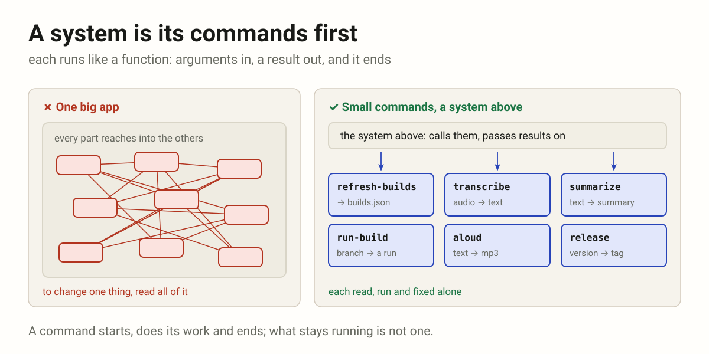
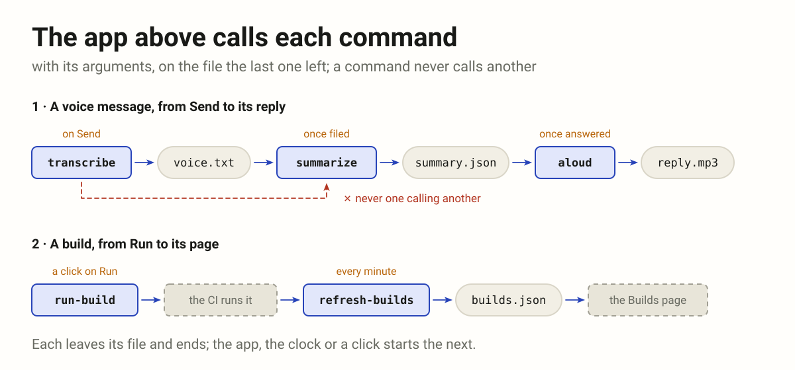
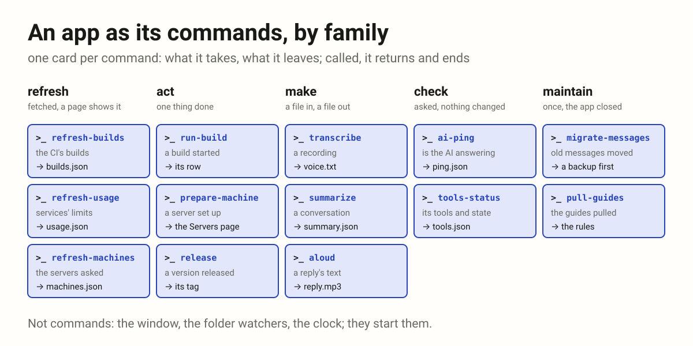
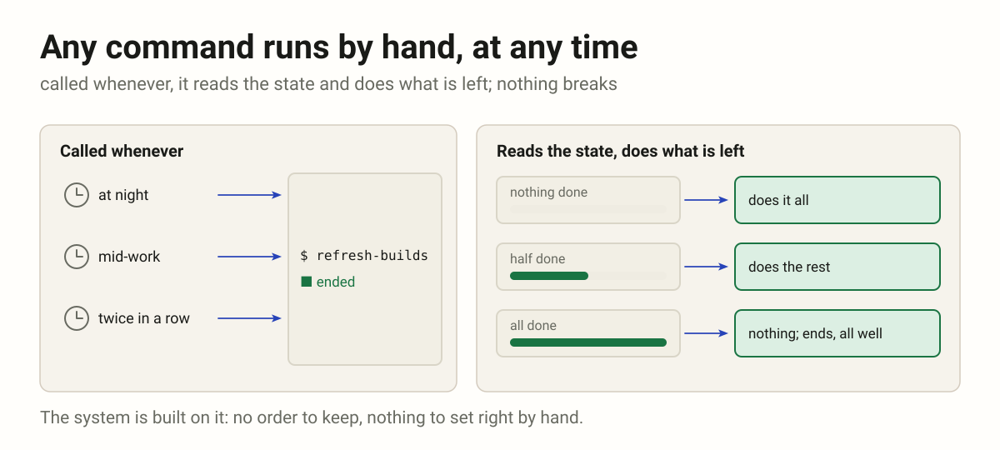
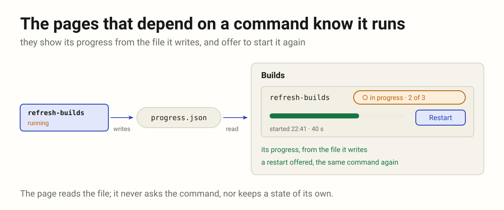
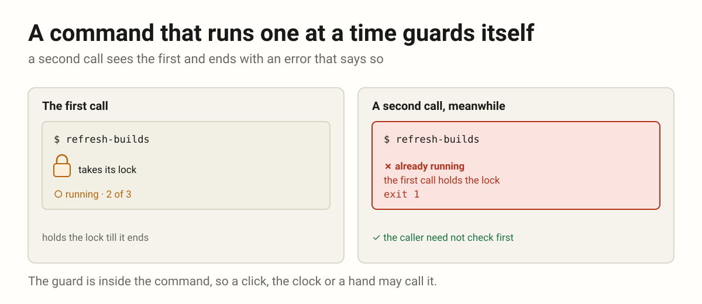

# System

How a system is built: the history of actions, a command above and its
records under it; and a system as commands, each run like a function, a
system above calling them. Research still: these rules settle here, apart
from the rules of the code.

9 rules · 2 groups · 2 sources · filterable version: [system.html](system.html)

The rules of the code are in [rules.md](rules.md); these keep their codes
while they settle.

| Tag | Group | Rules | |
|-----|-------|------:|---|
| HIST | The history of actions | 3 | A command above, its records under it. |
| CMD | A system as commands | 6 | Small commands, each like a function; a system above calls them. |

| Code | Rule | Canonical form | Source |
|------|------|----------------|--------|
| **HIST** | **The history of actions** — A command above, its records under it. | | |
| HIST-01 | **Every model writes three kinds of record: created, updated, deleted.** One row per change in the database, named after the model, `post_created`; no other kind at this level: publishing a post is a command, `api2_publish_post`, and its record is `post_updated`. |  | [history.md](../drafts/history.md) |
| HIST-02 | **Every record points up to its command, named by its entry point.** The call that caused the change is written first, `api2_create_project`, `api2_publish_post`; each record it causes carries its id. |  | [history.md](../drafts/history.md) |
| HIST-03 | **Two levels, always.** Under a command only records: never a record without one, never a command under a command. |  | [history.md](../drafts/history.md) |
| **CMD** | **A system as commands** — Small commands, each like a function; a system above calls them. | | |
| CMD-01 | **A system is its commands first.** Each thing it does is one command: a name, an input, an output; it starts, does its work and ends; run, read and debugged alone. |  | [commands.md](../drafts/commands.md) |
| CMD-02 | **The app above calls the commands; they never call one another.** It picks a command, packs its arguments, calls it and passes the result on. A command takes its arguments, runs as often as needed, and is read apart from the rest. |  | [commands.md](../drafts/commands.md) |
| CMD-03 | **Every command is drawn.** One picture per command, what goes in and what comes out, and one of how they connect; made with the command, kept beside it. |  | [commands.md](../drafts/commands.md) |
| CMD-04 | **Any command runs by hand at any time.** The system is built on it: called whenever, the command reads the state and does what is left; nothing breaks. |  | [commands.md](../drafts/commands.md) |
| CMD-05 | **The pages that depend on a command know it runs.** They show its progress from the file it writes, and offer to start it again. |  | [commands.md](../drafts/commands.md) |
| CMD-06 | **A command that runs one at a time guards itself.** A second call sees the first and ends with an error that says so; the caller need not think of it. |  | [commands.md](../drafts/commands.md) |
