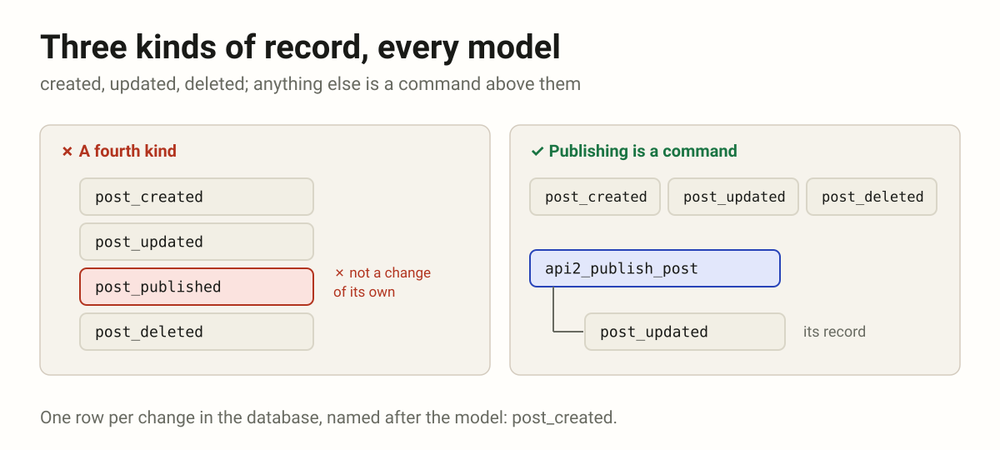
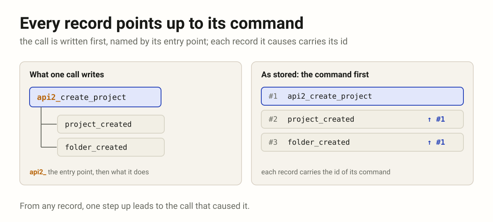
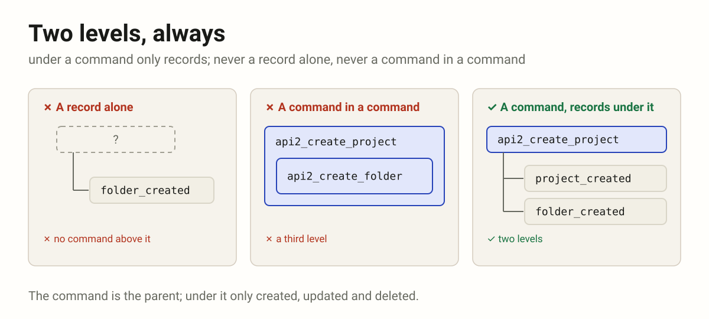

# System

How a system is built: first, the history of actions, a command above and
its records under it. Research still: these rules settle here, apart from
the rules of the code, and the approach with commands joins them later.

3 rules · 1 group · 1 source · filterable version: [system.html](system.html)

The rules of the code are in [rules.md](rules.md); these keep their codes
while they settle.

| Tag | Group | Rules | |
|-----|-------|------:|---|
| HIST | The history of actions | 3 | A command above, its records under it. |

| Code | Rule | Canonical form | Source |
|------|------|----------------|--------|
| **HIST** | **The history of actions** — A command above, its records under it. | | |
| HIST-01 | **Every model writes three kinds of record: created, updated, deleted.** One row per change in the database, named after the model, `post_created`; no other kind at this level: publishing a post is a command, `api2_publish_post`, and its record is `post_updated`. |  | [history.md](../drafts/history.md) |
| HIST-02 | **Every record points up to its command, named by its entry point.** The call that caused the change is written first, `api2_create_project`, `api2_publish_post`; each record it causes carries its id. |  | [history.md](../drafts/history.md) |
| HIST-03 | **Two levels, always.** Under a command only records: never a record without one, never a command under a command. |  | [history.md](../drafts/history.md) |
