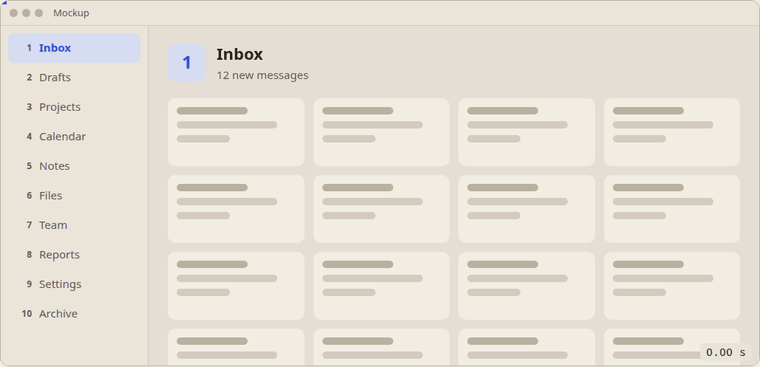
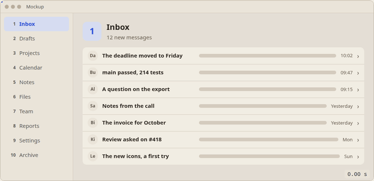
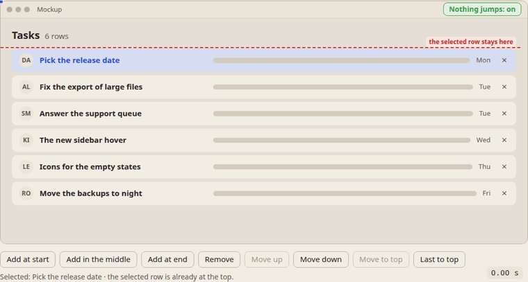
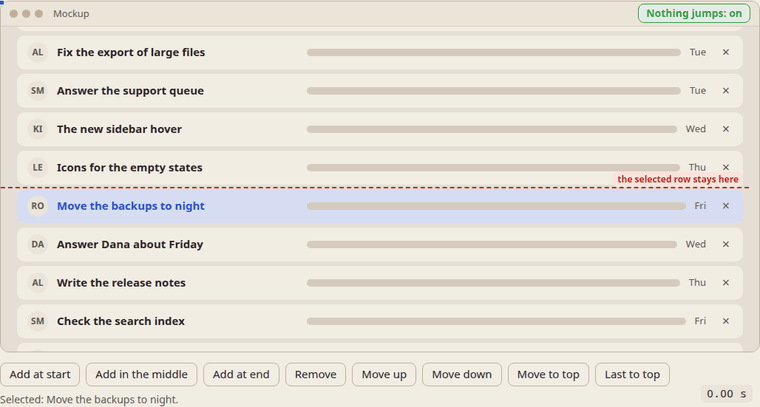
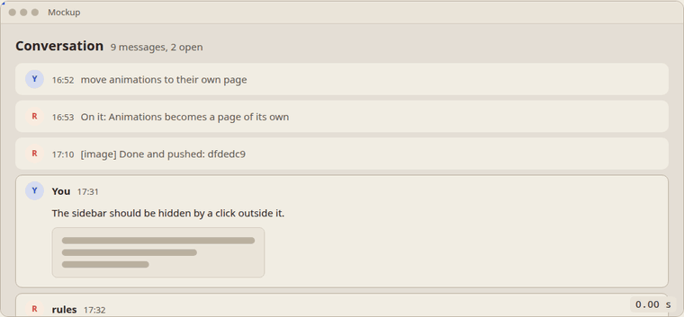

- a section on animations, animations for the UI: beautiful, good, working
  well; maybe a language comes out of it, for I am tired of explaining to the
  agent what I want, and showing it may be faster and simpler
- a mockup: a sidebar and the main area, the content
- switching between the sidebar's items, from the first to the second, to the
  third: as if the rectangle over the first item slides down to the second,
  and the viewport slides down with it; the first page flies up, the second,
  from below, rises and takes its place
- like switching workspaces in GNOME: from the first to the second, the first
  flies left and the second comes from the right; from the second to the
  tenth, the same, the second left, the tenth from the right; from the eighth
  to the seventh, the eighth goes right and the seventh comes from the left
- the next one: the same, only the container holds whole rows, the first, the
  second, the third; clicking a row, its page slides in from the right, as if
  you move right; you go into the element and see its details
- a Back button: you go back the way you came
- clicking the next item in the sidebar then scrolls up or down the same way
- on a row's page, clicking its own section in the sidebar works as Back:
  exactly right
- something added to a list or removed from it, in the middle, at the start, at
  the end, or moved: all of it animated too
- we already have the rule: when something is added to a list, the working
  element, the active one, always stays in the same place; the scrollbars and
  the scroll position change so that after all the changes it stays where it
  was; this is very important
- show this rule, nothing jumps: it matters
- add a new type of animation: see the headers
- too much is shown here: one, two, three variants of such cards are
  enough; and the change is wrong: when it folds, the icon morphs into its
  new size and place, the time and the text too, they move to their new
  place; not something disappearing and something appearing, the elements
  really morph into their new place; it's more morphing than
  transformations
- another example of header morphing: the lines join into one, smooth and
  neat; the elements of one state pass into the other smoothly, beautifully

# Animations

An animation shows where things went. The reader clicks the next section and
sees the page leave the way the list goes; they open a row and see its page
come in from the side they stepped towards; a row is added and they see the
gap open for it. Without the movement, the screen just changes, and the
reader has to work out what happened. With it, the change explains itself,
and the same kinds of change always move the same way, so the reader learns
them once.

The demo is [animations.html](animations.html): four mockups, each with the
rules it follows and a choice of duration, from 250 ms to 2 s to watch it
slowly. Each animation has a name to use in a message: `slide-workspaces`,
`slide-into-row`, `list-changes` and `expand-collapse`.

## Sections slide the way the list goes

A sidebar lists the sections. Picking another one slides the content
vertically, in the direction of the list, the way GNOME switches workspaces.
Going down the list, the old page leaves upward and the new one rises from
below to take its place. Going up the list, the old page leaves downward and
the new one comes from above.

<picture>
  <source media="(prefers-color-scheme: dark)" srcset="animations-sections-dark.gif">
  
</picture>

- **A far jump is one slide.** From 2 to 10 the content does not pass
  through 3 to 9: the two pages slide, and only the highlight crosses the
  items between them.
- **The highlight and the content move together.** The selection slides
  from the old item to the new one, at the same time, with the same duration
  and easing as the content. The item's colour changes as it passes.

## Depth is left and right

A section that holds rows lets the reader step into one. Clicking a row
moves the list out to the left as the row's page comes in from the right,
as if the reader moved right. Back steps out the other way: the page leaves
to the right and the list returns from the left. Sections still slide up and
down, from the list or from a row's page: vertical is which section,
horizontal is how deep.

<picture>
  <source media="(prefers-color-scheme: dark)" srcset="animations-rows-dark.gif">
  
</picture>

On a row's page, the row's own section in the sidebar works as Back: the
reader asks for that section, and the section is its list.

## A list shows each change as movement

- **Added:** the rows below slide down to open a gap, and the new row fades
  into it, at the start, in the middle or at the end.
- **Removed:** the row fades out where it stands, and the rows below close
  the gap.
- **Moved:** the row travels to its new place over the others, while they
  shift to make room.

<picture>
  <source media="(prefers-color-scheme: dark)" srcset="animations-list-dark.gif">
  
</picture>

## A list change never moves the working row

The selected row is the one the reader works with. Rows added or removed
above it never move it on the screen: the scroll position takes up the
difference, and only the rows around it move. This is UIM-01, nothing jumps,
held while the list animates: the row stands still from the first frame to
the last, not only at the end.

<picture>
  <source media="(prefers-color-scheme: dark)" srcset="animations-nothing-jumps-dark.gif">
  
</picture>

The demo marks the row's place with a dashed line, and a switch turns the
rule off to show the jump it prevents. A change the reader makes to the
selected row itself is theirs: removing it keeps the row above in place and
the next row takes its place; moving it keeps the row above in place and the
view follows the row it moved.

Two cases have nothing to take up the difference: a list that fits without
scrolling has no scroll position to change, and a list scrolled to its very
end cannot scroll further. There a row added above, or removed below, still
moves the selected one.

## A click mid-way changes course

A click during an animation never waits for it to end and never jumps back
to where it started. Every element starts its next movement from where it is
on the screen at that moment: Back during the step into a row turns it
around, a section picked during it carries both pages away together, and
five rows added in quick succession all animate and never overlap at the
end.

<picture>
  <source media="(prefers-color-scheme: dark)" srcset="animations-mid-way-dark.gif">
  
</picture>

## A header opens its message and folds it back

A message is either folded to one line, a small avatar, its time and the
start of its text, or open in full, a larger avatar, the name, the time,
the whole text and maybe a picture. Clicking a folded header opens the
message, clicking the open one folds it back. Nothing disappears to be
replaced by something else: the parts the two layouts share morph from one
into the other. Folding, the avatar shrinks into its place in the line, the
time moves beside it, and the text glides up into the one line at its
smaller size; opening, they morph back. Only what has no place in the line,
the name, the picture, the words past the first line, fades. Without the
morph, the reader sees one card swapped for another and has to find the
avatar, the time and the words again.

The third card is a voice message as the author's own app shows it: open,
three status lines in a code box, a player, the transcript, a file; folded,
one line. Its three lines join into that line: each glides to its own place
in reading order and takes the line's size, so the breaks between them go
without a jump. The transcript's first words travel to after a 🎙 mark; the
date beside the time fades as the time moves left; the pill keeps its box
and the words "In progress", and only "for 1 min" narrows away as the box
shrinks to fit.

<picture>
  <source media="(prefers-color-scheme: dark)" srcset="animations-expand-dark.gif">
  
</picture>

- **The parts morph, nothing pops.** The avatar, the time and the text are
  the same in both layouts; each travels from where it is to where it goes
  and takes its new size on the way.
- **Lines join into the one line.** Several lines each glide to their own
  place in the folded line, in reading order; none waits for another, and
  no line break jumps.
- **A word group narrows.** A pill or a date that is shorter folded keeps
  its box and shared words; the box resizes and only the extra words go.
- **What has no place fades.** The name, the picture and the rest of the
  text fade out as the card folds, and in as it opens; the card's height
  goes from the one to the other with them.
- **The header stays put.** The header clicked stands still from the first
  frame to the last; only what is below it moves (UIM-01). The demo marks
  its place with a dashed line.
- **A click mid-way turns it back.** Every part starts back from where it
  stands on the screen at that moment, at the size it has then.

## How the demo moves

All the movements share one duration, 400 ms by default, and one easing,
`cubic-bezier(.2, .8, .2, 1)`: fast at the start, settling at the end. The
pages move as one strip: a new page joins it next to the current one, on the
side it comes from, and the strip moves until the new page stands in place.
A list measures every row before and after a change and plays the difference
(FLIP), so a change mid-way starts from where the rows are. A message card measures each part
that both layouts have where it is seen, switches its layout, measures them
again and morphs each one from the first box to the second; a text that
changes its look, from a code line to a line of the header, has a copy of
its old look travel with it and fade. A pill held by its right edge resizes
while its extra words narrow away, and a click mid-way starts from where
everything stands. The GIFs are
recorded from the demo frame by frame at 30 frames a second, with the time
and a progress bar (DOC-14).
