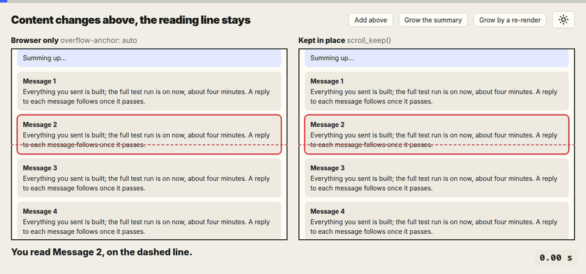

- rules for making GIFs, at least for the documentation
- a GIF must show its time, as it runs: 0, 1, … at 30 frames a second
- at the top, a thin bar that shows the progress
- both are a must for a GIF, to make the progress as visible as possible
- the GIFs already here are good and do everything right, but they have no progress bar at the top

--- ✨ AI-Generated Content Below ✨ ---

# GIFs in the docs

A GIF in the docs shows something that moves or changes: a comment that
appears at once, a reading line that stays while the content above it
grows. A reader watching it needs to know where they are in it: how far in,
how long a step took, and where it loops back to the start. A GIF alone
says none of that. So every GIF carries two marks, the time and a progress
bar.

<picture>
  <source media="(prefers-color-scheme: dark)" srcset="scroll-anchoring-dark.gif">
  
</picture>

## The rule

- **The time.** A corner of the GIF shows the time from its first frame,
  `0.00 s`, counting with every frame, in the GIF's own code font and
  colours. It sits where the GIF has no content, most often at the bottom
  right.
- **The progress bar.** A thin bar runs along the top edge, the whole
  width, in the GIF's accent colour over a faint track. It fills frame by
  frame and is full on the last frame.
- **30 frames a second.** The GIF is recorded at 30 frames a second, so the
  time steps by a thirtieth of a second, the same in every GIF. A GIF whose
  pictures only change now and then is still recorded at 30.
- **The loop shows.** When the GIF starts again, the time goes back to
  `0.00 s` and the bar empties: the reader sees where the loop begins.

## Why

Without the time, a delay cannot be read off the GIF: "the comment shows
after two seconds" is a claim the reader has to take on trust. Without the
bar, the reader cannot tell a pause from the end, and a GIF that loops
quickly looks like one that never stops. Both marks cost a few pixels and
leave the picture itself as it was.

## How the GIFs here are made

Each GIF's frames are drawn from its demo page at 30 frames a second, then
the time and the bar are stamped on every frame. The demo pages say how
their frames are made:
[optimistic-updates.html](optimistic-updates.html) draws any moment with
`refresh_frame(ms)`, and [scroll-anchoring.html](scroll-anchoring.html) is
recorded in three states, each held for its time.
