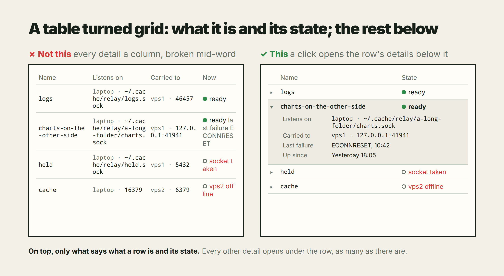

- A new rule for making tables, for the UI.
- When a table comes out like the one in the picture, it has to be redone:
  as soon as it stops being a table and turns into some kind of grid.
- At the top level keep only the most important columns: looking at them,
  one understands what it is and what state it is in.
- A click on such a row opens its details below it, and there can be many.
- So when the details are more than the table can show on one screen, they
  all move behind one more click, and the top level keeps only the columns
  that say what it is and what state it is in.

# A crowded table opens its details below

A table that has to show everything about each row stops being a table.
The fix is fewer columns: those that say what the row is and what state it
is in. The rest opens under the row, on a click.

<picture>
  <source media="(prefers-color-scheme: dark)" srcset="table-details-dark.png">
  
</picture>

The picture is drawn by [table-details.html](table-details.html) and
rendered to `table-details.png` and `table-details-dark.png` (`?dark`).

## Why

A table is read along its rows and down its columns: the eye finds a row by
its name and reads across. That works while each cell is one short line.
Once every detail of a row is a column, the columns get narrow, the cells
wrap over three or four lines, and paths and messages break in the middle
of a word. The rows grow to different heights, the columns stop lining up
for the eye, and nothing can be read at a glance: not which row is which,
not which one is in trouble. It looks like a table and reads like a grid
of fragments.

The reader comes to a table with two questions: what is there, and is it
all right. Those two need a column or two. The details are wanted for one
row at a time, when that row is the one being looked into.

## The rule

1. **A table that turns into a grid is redone.** The signs: cells wrap over
   several lines, words or paths break in the middle, columns are cut off
   or the table scrolls sideways. Then the details are more than one
   screen can show as columns, and adding or narrowing columns does not
   help.
2. **The row shows what it is and its state.** On top stay only the columns
   needed to tell what a row is (its name) and what state it is in (a
   status, a dot and a word). A row of them reads at a glance, on one line.
3. **A click opens the details below the row.** Every other value goes to
   the row's details, opened by a click on the row, right under it and as
   wide as the table: one line per detail, its label and its value, as many
   as there are. A long value wraps there whole, at its own breaks; another
   click closes the details. The row clicked stays where it was (UIM-01).

A detail that the reader needs to compare across all rows, such as a size
or a time, may stay on top as a column, as long as the rows still read on
one line. When it does not fit, it goes below with the rest.
