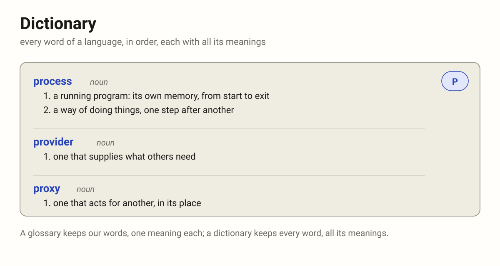

# Documents (WORD)

Words about words.

- vocabulary – which words we have/use
- glossary – the words of a vocabulary, with their description and meaning
- dictionary – every word of a language, in order, each with all its meanings

## Vocabulary

## Glossary

## Dictionary

Every word of a language, or of a whole field, in alphabetical order, each
with all its meanings, its part of speech and how it is used. Where a
glossary keeps only our words and the one meaning we give each, a
dictionary keeps every word and every meaning; a glossary is chosen, a
dictionary is complete. In code a dictionary is something else: a map from
keys to values (`user_by_id`).

