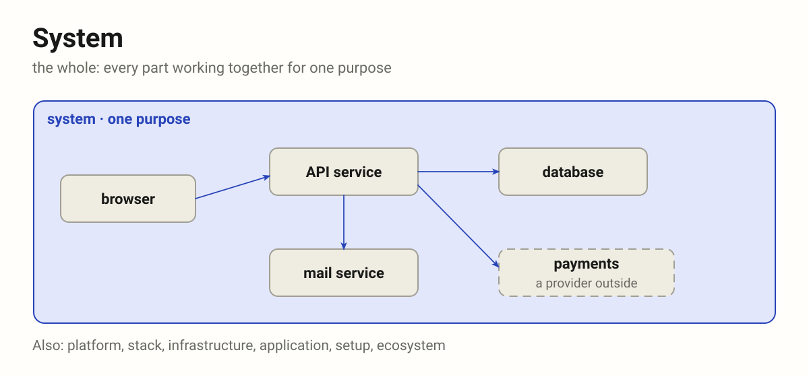
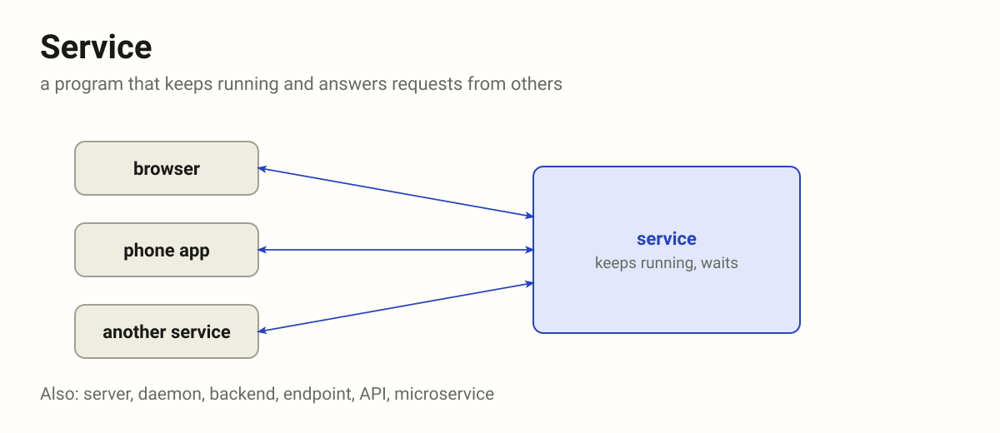
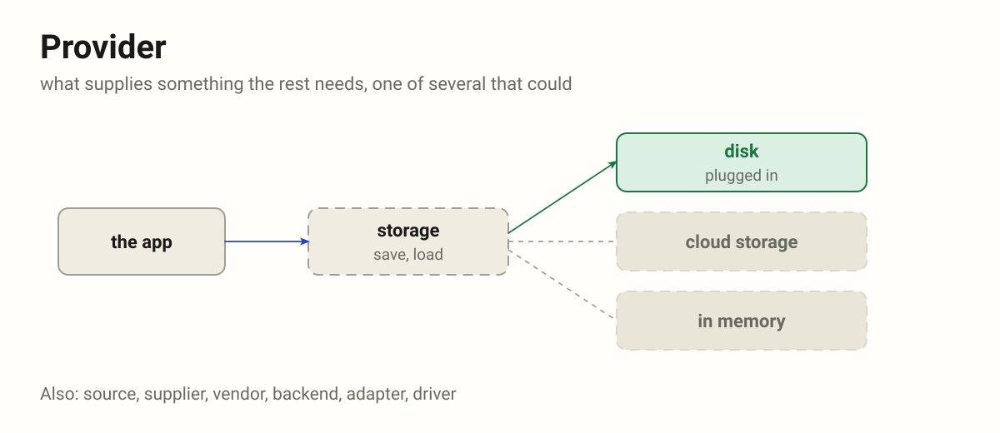
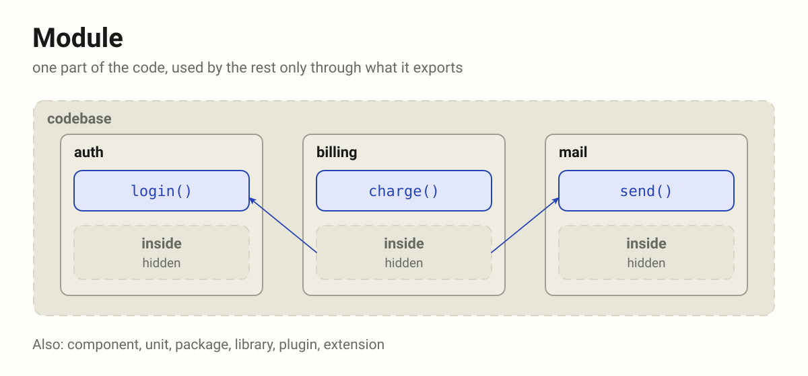
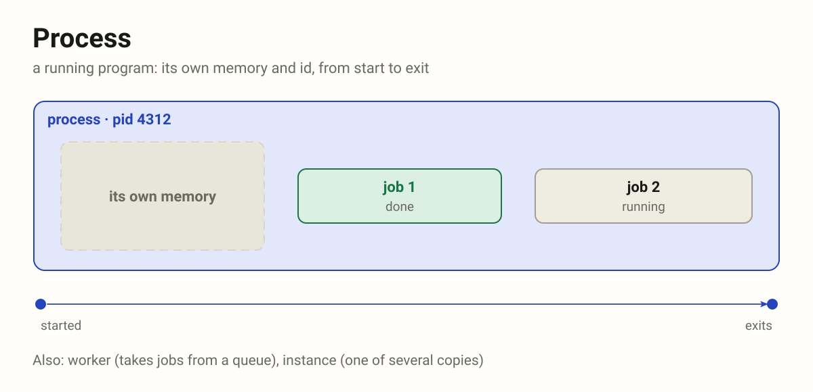
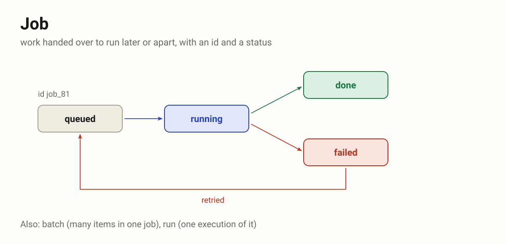
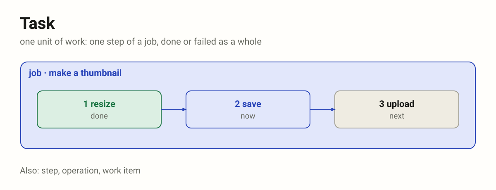
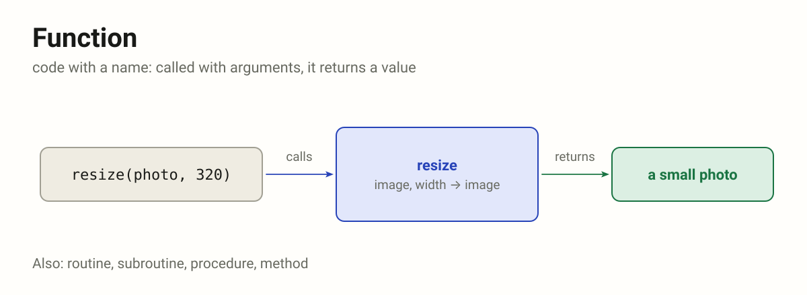
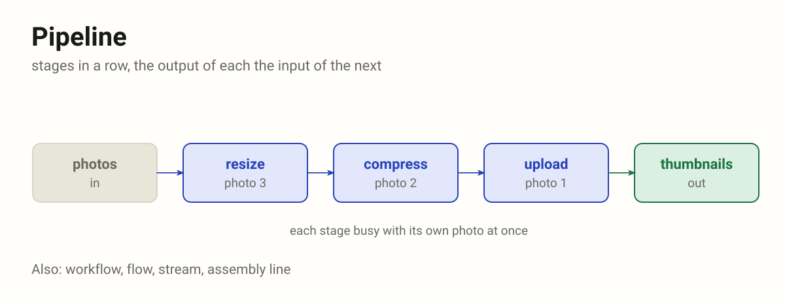
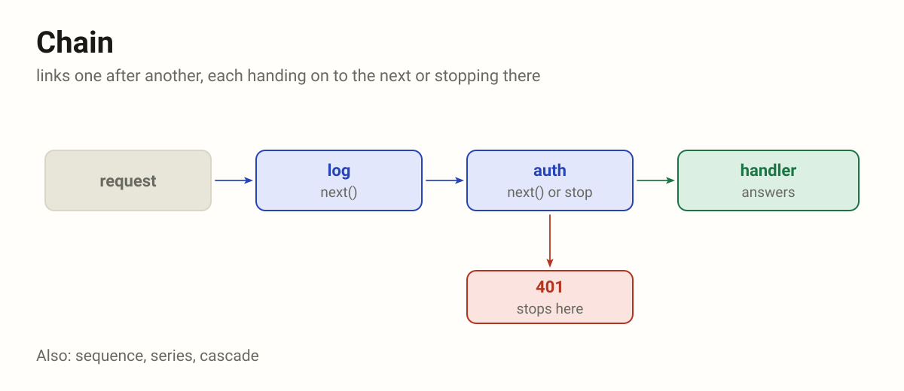

# Architecture (ARCH)

Words for what software is made of and for the work it does, each with the
words that can stand in for it.

**Parts** (WHOLE)

From the whole down to a part of the code.

| Term     | Definition                                                                                                                                  |
|----------|---------------------------------------------------------------------------------------------------------------------------------------------|
| system   | The whole: every part working together for one purpose. Also: platform, stack, infrastructure, application, setup, ecosystem.               |
| service  | A program that keeps running and answers requests from others. Also: server, daemon, backend, endpoint, API, microservice.                  |
| provider | What supplies something the rest needs, one of several that could. Also: source, supplier, vendor, backend, adapter, driver.                |
| module   | One part of the code with a job of its own, used by the rest only through what it exports. Also: component, unit, package, library, plugin. |

**Work** (WORK)

What gets done and what does it: the first four each hold the next, the last two put work in a row.

| Term     | Definition                                                                                               |
|----------|----------------------------------------------------------------------------------------------------------|
| process  | A running program, its own memory, from start to exit. Also: worker, instance.                           |
| job      | Work handed over to run later or apart, with an id and a status. Also: batch, run.                       |
| task     | One unit of work, one step of a job. Also: step, operation, work item.                                   |
| function | Code with a name: called with arguments, it returns. Also: routine, subroutine, procedure, method.       |
| pipeline | Stages in a row, the output of each the input of the next. Also: workflow, flow, stream, assembly line.  |
| chain    | Links one after another, each handing on to the next or stopping there. Also: sequence, series, cascade. |

## System

The whole: every part working together for one purpose, the browser, the
services, the databases and the providers outside. A word for when the
parts matter less than what they do together.

Also: **platform** (others build on it), **stack** (layers on top of each
other), **infrastructure** (what runs the rest), **application** (what the
user touches), **setup** (one arrangement of it), **ecosystem** (many
owners). On the Agents glossary `system` is the system message, not this.

## Service

A program that keeps running and answers requests from others, often over
the network: started once, then waiting, serving many callers in turn.

Also: **server** (the program or the machine it runs on), **daemon** (runs
in the background, no screen), **backend** (behind a front end),
**endpoint** or **API** (its doorway, not the whole), **microservice** (one
small service among many). "A service" may also mean what is offered, not
the program: then **facility** or **utility**.

## Provider

What supplies something the rest needs (files, sign-in, e-mail, payments),
one of several that could: the code asks for the thing, and whichever
provider is plugged in gives it.

Also: **source** (where data comes from), **supplier**, **vendor** (a
company), **backend** (the one behind a common front), **adapter** or
**driver** (one swappable piece of code per provider).

## Module

One part of the code with a job of its own, used by the rest only through
what it exports. Inside it may change freely; its exports are its promise.

Also: **component** (a part, often of a screen), **unit** (the smallest part
tested alone), **package** or **library** (shipped and versioned apart),
**plugin** or **extension** (added from outside), **building block**.

## Process

A running program: its own memory, its own id (pid), from start to exit. The
operating system runs it; it runs jobs, tasks and functions. A **worker**
is a process that takes jobs from a queue; an **instance** is one of
several copies of the same program.

"Process" may also mean a way of doing things, not a program: then
**procedure** or **workflow**.

## Job

Work handed over to run later or apart: it gets an id and a status the
caller can look up, queued, running, done or failed, and may be retried or
run on a schedule.

Also: **batch** (many items in one job), **run** (one execution of it).
Tools draw the lines their own way: in CI a job holds steps, in Kubernetes a
Job starts pods.

## Task

One unit of work to do: one step of a job, small enough to finish or fail
as a whole. Often a function call put in a queue.

Also: **step** (one in an order), **operation**, **work item**.

## Function

Code with a name: called with arguments, it returns a value. No life of its
own; it runs for the length of one call.

Also: **routine** or **subroutine**, **procedure** (often one that returns
nothing), **method** (a function of an object).

## Pipeline

Stages in a row, the output of each the input of the next: data goes in at
one end and comes out changed at the other. Each stage does one thing and
knows only its neighbours, so all of them can be busy at once, each with
its own item. A shell's `a | b | c`, a build, a CI pipeline.

Also: **workflow** (the steps, often with people in them), **flow**,
**stream** (items one by one, without end), **assembly line**.

## Chain

Links one after another, each handing on to the next or stopping there.
What goes along is control, a request or a call, not data being changed:
middleware (`next()`), a promise chain (`.then()`), method chaining, a
chain of responsibility. Where a pipeline changes data stage by stage, a
chain passes a turn, and any link may end it.

Also: **sequence**, **series**, **cascade** (each step sets off the next).

