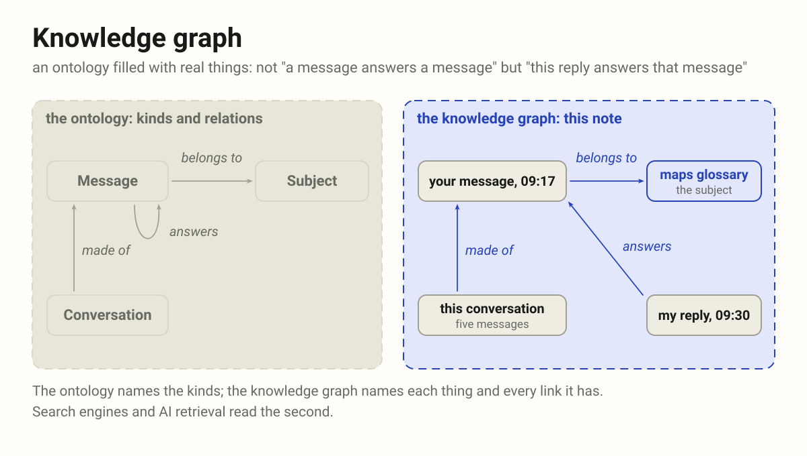
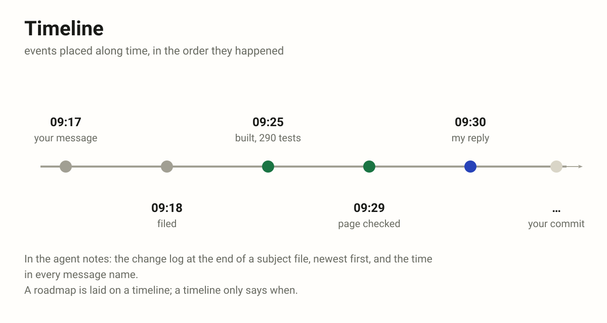
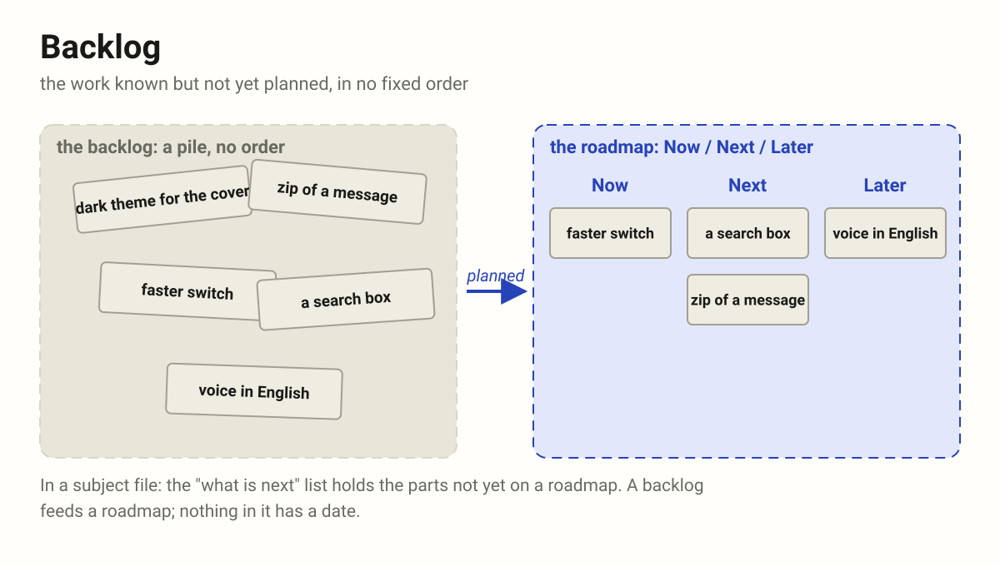
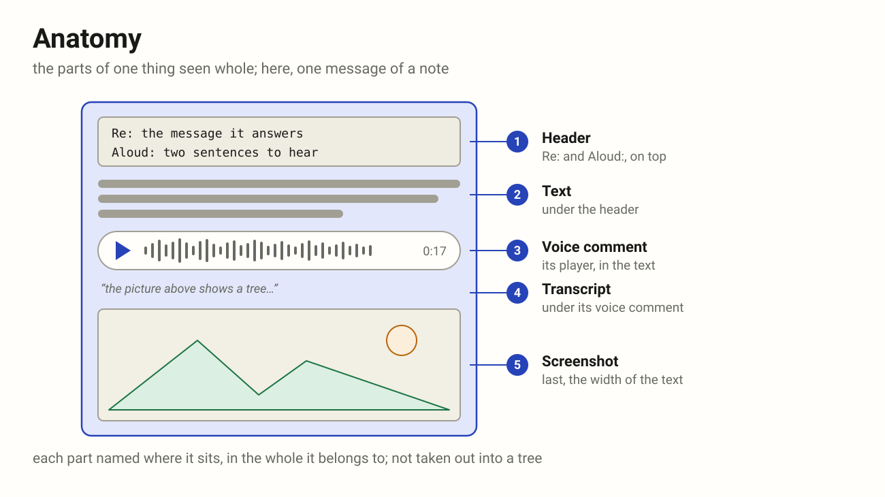
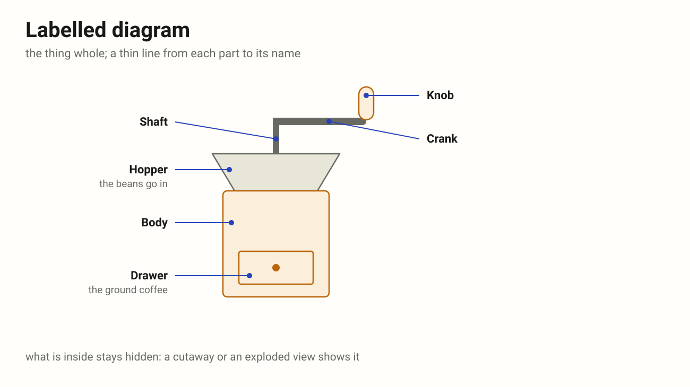
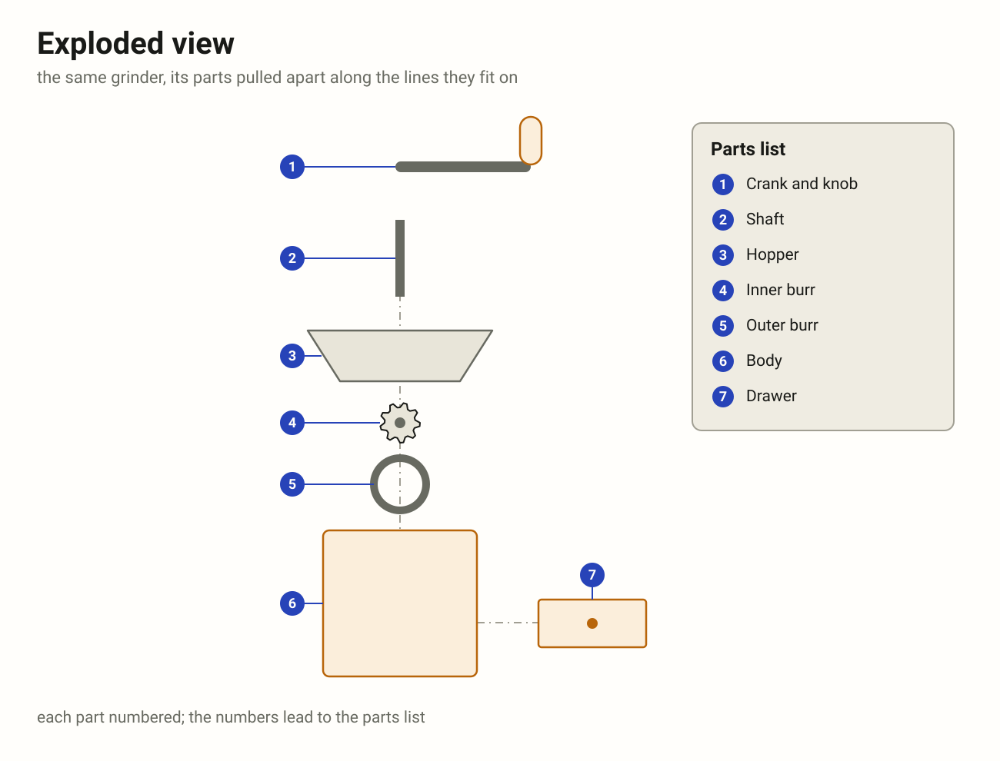
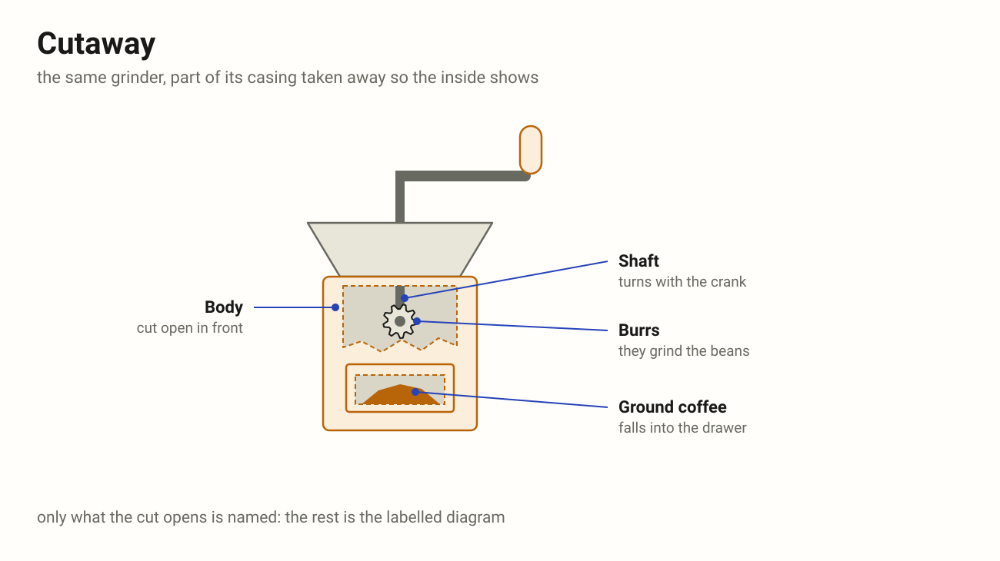
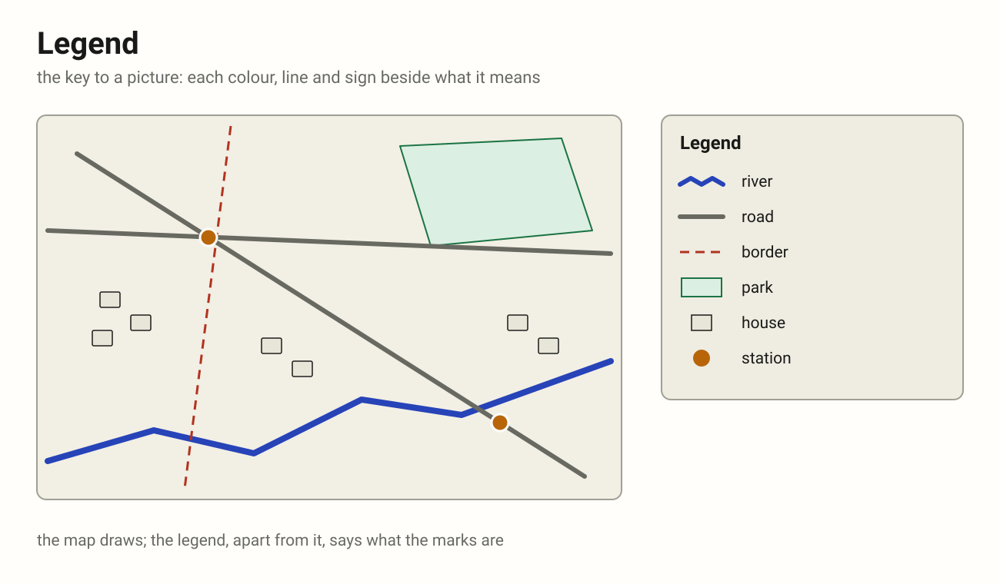

# Maps and ways (MAP)

Words for the shapes knowledge takes, and for the way a piece of work goes:
where we are, where we came from, where we are going.

| Term            | Definition                                                                                                    |
|-----------------|---------------------------------------------------------------------------------------------------------------|
| tree            | One root; every other node has exactly one parent; no circles. Folders, outlines, an org chart.               |
| graph           | Nodes and edges, directed or not, with no rule on how they link: several parents, circles.                    |
| map             | A smaller picture that keeps what matters of something bigger and leaves the rest out on purpose.             |
| taxonomy        | Kinds and kinds of kinds, each one "is a" the one above it (animal › bird › owl). A tree of kinds.            |
| ontology        | The concepts of a field, their instances, the relations between them and their rules, written down.           |
| knowledge graph | An ontology filled with real things: not "a message answers a message" but "this reply answers that message". |
| roadmap         | The whole way ahead: where we go and in what order, not exactly when. Now / Next / Later.                     |
| milestone       | One point on the way, reached or not. Takes no time, unlike a task.                                           |
| breadcrumbs     | The trail behind: from the root to where you stand, each crumb a way back (Home › Docs › Page).               |
| timeline        | Events placed along time.                                                                                     |
| backlog         | Work known but not yet planned, in no fixed order.                                                            |
| anatomy         | The parts of one thing and where they sit, each one "part of" the one above it (button › icon, label).        |
| labelled diagram | A thing drawn whole, a thin line from each part to its name.                                                 |
| exploded view   | A thing's parts pulled apart along the lines they fit on, numbered for a parts list.                          |
| cutaway         | A thing drawn with part of its casing taken away, so the inside shows.                                        |
| legend          | The key of a picture: what each colour, line and sign means, set apart from the drawing.                      |

## Tree

One root, and every other node has exactly one parent, so there are no
circles and exactly one path from the root to any node. Folders, an outline,
an org chart, a family line.

In the agent notes: the folders of a note (agentdir, commondir, messages,
roadmaps). A thread is a tree as long as each message answers one message.

A tree is a graph with rules; a taxonomy is a tree of kinds.

## Graph

Things (nodes) and the links between them (edges), directed or not, with no
rule on how they link: a node may have several parents, and links may run in
circles.

The pages of this site are a graph: the README links to Rules and to
Glossaries, Rules links to Glossaries, Glossaries to Agents, and Agents back
to Rules. Glossaries has two parents, and three pages link in a circle; a
tree allows neither.

Trees, taxonomies and ontologies are all graphs with rules added.

## Map

A smaller picture that keeps what matters of something bigger: where things
are and how they connect. "The map is not the territory": a map leaves things
out on purpose. In code, a map (a dictionary) goes from keys to values, one
value per key. Also a mind map, a concept map, a site map.

In the agent notes: a roadmap is a map of the way; "the terms and how they
relate" below is a concept map; a glossary maps each term to its meaning.

## Taxonomy

Sorting into kinds and kinds of kinds, each one "is a" the one above it:
animal › bird › owl. Linnaeus for living things, the shelves of a library.

In the agent notes: a message is the author's or the agent's; a page is a
subject file, a cover or a plan; a marker is `.working` or `.cancelled`.

A taxonomy is a tree, and the backbone of an ontology, which adds the other
links.

## Ontology

In philosophy, the study of what exists. In computing, a written map of
what a field talks about, in four parts: the kinds of things (a message, a
conversation, a subject file), the things themselves (your message of this
morning asking for a glossary is a message), the relations between them (a
conversation is made of messages; a reply answers a message) and the rules
(every conversation has exactly one subject file). It is written down so
that people and programs use the words the same way: RDF and OWL are the
standards, Schema.org the best known on the web.

A glossary defines words one by one; an ontology also says how they connect.
Written down once, a rename (workdir became subjectdir) happens in one place,
and an agent can check a word against it.

## Knowledge graph

An ontology filled with real things: not "a reply answers a message" in
general, but "my reply of 09:30 answers your message of 09:17", one link
for each pair that has it. What search engines and AI retrieval use.

In the agent notes: every message, subject file and plan of a note with
their links; the app could build it, and it would feed an agent's context.

## Roadmap

The whole way ahead: where we are going and in what order, not exactly when.
A product roadmap is often three columns, Now / Next / Later. It changes as
we learn, and it is meant to be shown, so it stays coarse: themes and stages,
not tasks.

In the agent notes: an agent's plan for one conversation,
`roadmaps/<time>-agent-plan.md`, its parts `- [ ] **P1** …` ticked as each is
done, new ones added at the end; and the author's roadmaps in the app, lists
of work across projects.

A roadmap is laid on a timeline, marked by milestones and fed by a backlog.

## Milestone

The Roman stone by the road that said how far it was to Rome. In a project, a
point that is reached or not ("Released", "Signed"); it takes no time, unlike
a task. A diamond on a Gantt chart; on GitHub, a group of issues with a due
date.

In the agent notes: the goal's steps in a subject file, drawn under the
cover: done, now or next. The step that is now waits on the agent while it
works and on the author after its reply; a step is named as it stands
("Testing" while now, "Tested" once done); the last is always "Done: nothing
left, to the archive".

## Breadcrumbs

The trail that shows where you are and how you got there, as in Hansel and
Gretel; on a web page, Home › Docs › Page, each crumb a link back up.

Against roadmap and milestone: breadcrumbs look back (the way behind, from
the root to here), a roadmap looks ahead (the whole way, in order), and a
milestone is one stone on that way. A milestone passed is, in effect, a
breadcrumb.

In the agent notes: the path `agentdir › commondir › Terms`, and the chain of
`Re:` lines back to a conversation's first message.

## Timeline

Events placed along time. In the agent notes: the change log at the end of
each subject file, and the times in message names. A roadmap is laid on one.

## Backlog

The work known but not yet planned, in no fixed order. In the agent notes:
the "what is next" list of a subject file, the parts not yet on a roadmap. It
feeds a roadmap.

## Anatomy

The parts of one thing, seen whole: each part named where it sits, in the
thing it belongs to. Borrowed from biology (the anatomy of a hand), it is
common in computing: the anatomy of a button (a container, an icon on the
left, a label beside it), of a URL (scheme, host, path, query, in that
order), of a log line or of a file. Design systems give each component page
an Anatomy section: the component drawn once, each part numbered in place,
the names beside.

In the agent notes: a message as the app shows it, its header on top, its
text, a voice comment's player with the transcript under it, a screenshot
last.

A taxonomy sorts many things into kinds ("is a"); an anatomy opens one
thing ("part of"). The parts taken out and set in a tree are a meronomy,
which keeps what holds what but loses where each part sits: the anatomy is
the picture of the whole, usually a labelled diagram.

## Labelled diagram

A thing drawn whole, as it is seen, with a thin line (a callout, or leader
line) from each part to its name. Nothing is moved and nothing is opened, so
only the outside can be named. The common picture of an anatomy: a diagram
of a flower in a school book, a device's parts in its manual, a component in
a design system.

What is inside stays hidden; a cutaway opens it, an exploded view takes it
apart.

## Exploded view

The parts of a thing pulled apart along the lines they fit on, each in the
place it goes, so that every part is seen and the order of putting them
together can be read off the picture. Each part has a number; the numbers
lead to a parts list (in industry, a bill of materials). An assembly sheet
of flat-pack furniture is one.

It shows what a labelled diagram cannot: the parts behind other parts, and
how they go together.

## Cutaway

A thing drawn whole with part of its casing taken away, so the inside shows
in its place: the gears of a clock behind its face, the rooms of a ship
behind its hull. The edge of the cut is drawn, so it reads as opened, not
as missing.

Unlike an exploded view nothing moves: the inside is seen where it works.
Only what the cut opens is named; the outside is the labelled diagram's.

## Legend

The key of a picture: a small box, set apart from the drawing, with a
sample of each colour, line and sign and what it means. A map's legend says
that a blue line is a river and a dashed red one a border; a chart's says
which colour is which series. In British English also a key.

A label names one thing on the drawing itself; a caption says under the
picture what the whole shows; a legend explains the marks, once, for all of
them.

In the agent notes: the overview's colours (green done, orange waits on the
author, the accent at work), and the two samples at the top of this page's
terms map.

