# Motion (MOTION)

Words for how things move on a screen. The rules that use them are on the
Animations page (ANIM).

| Term     | Definition                                                                                                                  |
|----------|-----------------------------------------------------------------------------------------------------------------------------|
| morphing | One element turns into another: its shape, size and place change through every frame between, so the eye follows it as one. |
| fade     | An element comes or goes by its opacity alone, where it stands: the simplest smooth change.                                  |

## Morphing

One element turns into another: its shape, size and place change through
every frame between, so the eye follows it as the same thing, never one
thing swapped for another. A menu grows out of its button and shrinks back
into it; a chip opens into its field; a card's avatar shrinks into its
folded line while the time moves beside it.

It is the ideal animation: almost every animation rule is built on it. What
comes from something on the screen, or goes into it, morphs (ANIM-16); only
what has nothing to come from fades.

## Fade

An element comes or goes by its opacity alone, where it stands, its shape and
place unchanged: the simplest smooth change. It is for what has nothing to
morph from or into, a toast or a tooltip, and for the parts of a morph that
have no place in the other shape (ANIM-10). Never whole on one frame and gone
on the next.

