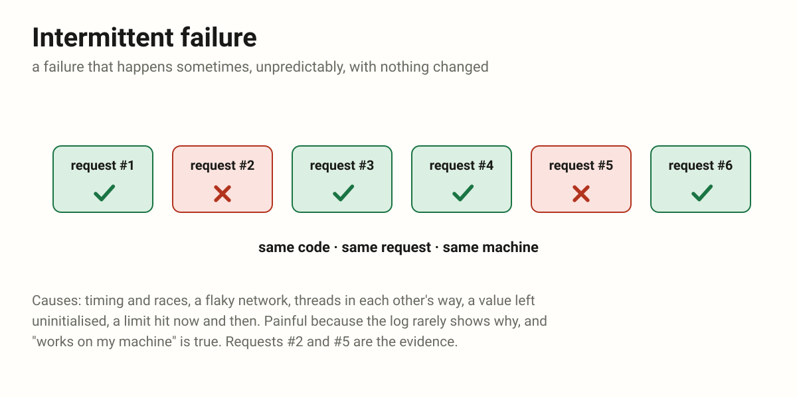
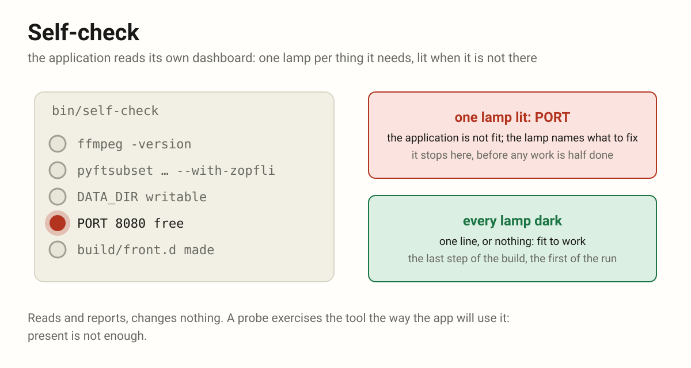
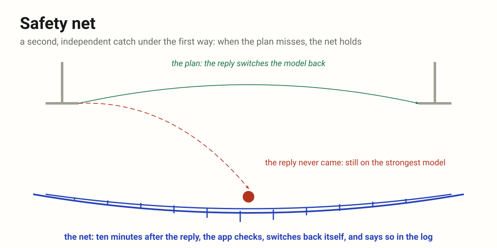
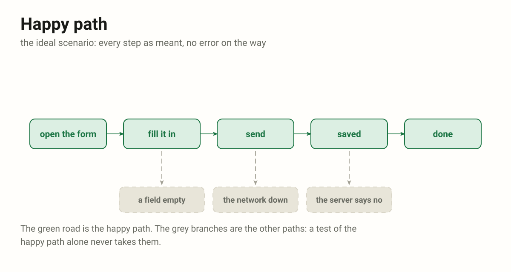
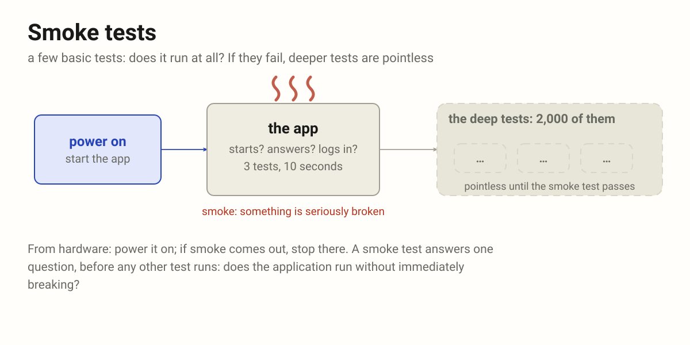
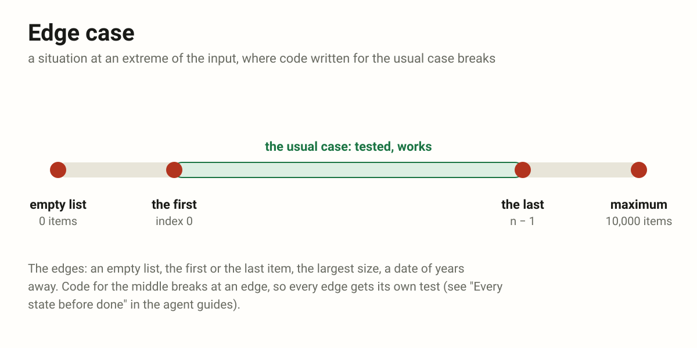
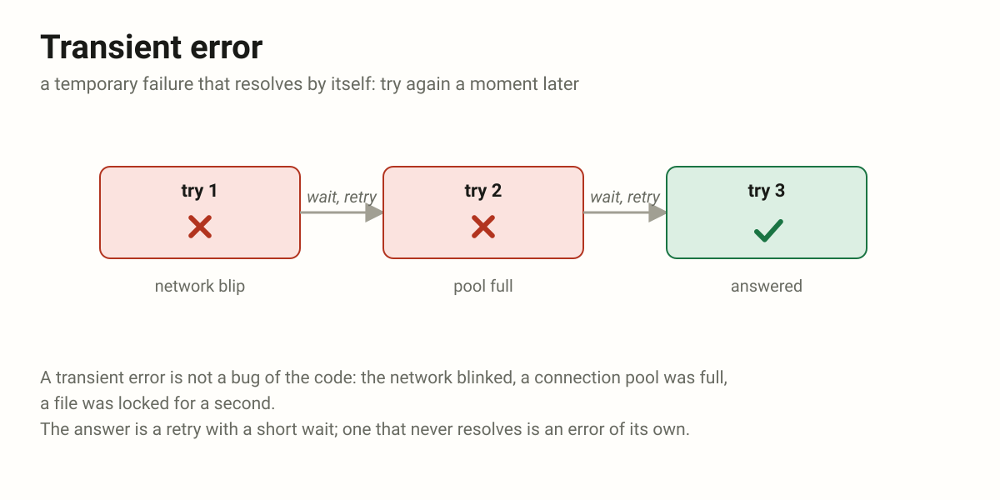
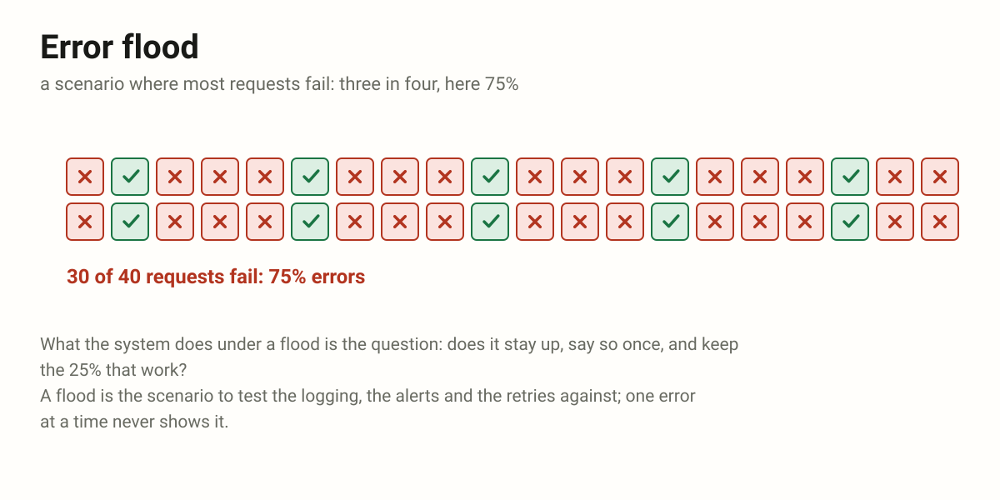
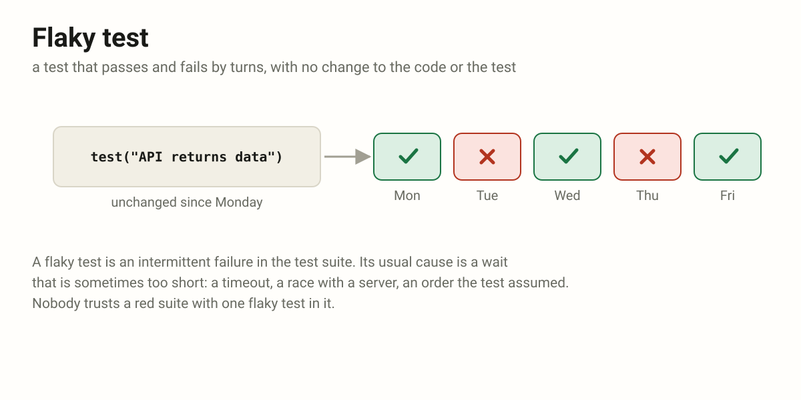
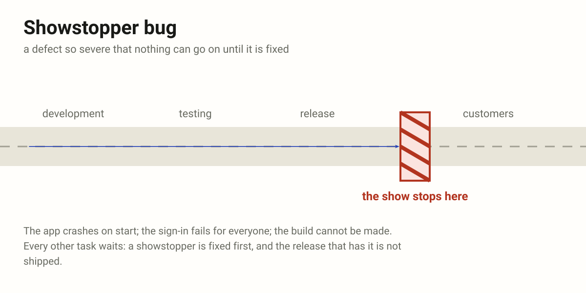

# Testing (TEST)

Words for failures, and for the tests that find them.

- [Happy Path](https://en.wikipedia.org/wiki/Happy_path) – the ideal scenario
  without errors
- [Smoke Tests](https://en.wikipedia.org/wiki/Smoke_testing_(software)) – a
  small set of basic tests that verify whether the most critical parts of a
  system work at all.  They answer one question: Does the application run
  without immediately breaking? If smoke tests fail, deeper testing is usually
  pointless. (Why "smoke"? From hardware: Power it on – if smoke comes out,
  something is seriously broken.)
- [Edge Case](https://en.wikipedia.org/wiki/Edge_case) – a situation at an
  extreme of the input – an empty list, the first or the last item, the
  maximum size – where code written for the usual case breaks
- Transient Error – temporary issues that resolve quickly
- Intermittent Failure – a failure that happens sometimes, unpredictably
- Error Flood – scenario with 75% errors (?)
- Flaky Test – tests that produce inconsistent results, sometimes passing and
  sometimes failing, without any changes to the code or test being tested
- Showstopper Bug – a defect so severe that it prevents the system from
  functioning or blocks further progress (development, testing, or release).
  Work cannot reasonably continue until it is fixed.
- Self-check – the application's own check that it is fit to work, as a
  car checks itself on the dashboard: one lamp per thing it needs, the
  programs it calls, the variables, the folders, what its build produced,
  each dark when the thing is there and works, lit when it is not. It reads
  and reports, changes nothing; one lit lamp names what to fix and stops it
- Safety net – a second, independent catch under the first way: when the
  usual mechanism fails or is forgotten, the net limits the damage. Not the
  plan, but what holds when the plan does not

## Intermittent failures

A failure that happens sometimes, unpredictably, and usually cannot be
reproduced consistently. Run #1 works, run #2 fails, run #3 works again — even
though nothing was changed.

Common causes: timing issues and race conditions, network instability,
concurrency issues (threads or processes interfering), uninitialized values,
hardware flakiness (bad RAM, overheating), resource limits hit sometimes (a
connection pool exhausted).

Painful because it does not fail every time, logs often do not show a clear
cause, and "works on my machine" happens a lot.

```js
// Sometimes fetch() returns slow, causing timeout.
// Sometimes it's fast. So the test occasionally fails.
test("API returns data", async function () {
    const response = await fetch("/api/data");
    expect(response.ok).toBe(true);
});
```



## Self-check

The application checks, by itself, that it is fit to work, as a car checks
itself on the dashboard: one lamp per thing it needs, dark when that thing is
there and works, lit when it is not. The lamps are the programs it calls, the
environment variables, the folders it writes, the port, the versions, and
what its own build was to produce. A lit lamp is the whole answer: the
application is not fit, and the lamp names what to fix. It changes nothing:
a self-check reads and reports. When every lamp is dark it says one line or
nothing; when one is lit it names it and stops, before any work is half done.

It runs where there is something new to check: the last step of the build
(PROJ-30), so an image that fails it is never shipped; and again as the first
step of the run when the host may differ from the build, so a host that
fails it does no work. One probe per lamp, each in its own strict shell, its
output prefixed with the lamp's name, so the log says which one lit. Present
is not enough: a probe exercises the tool the way the application will use
it (a font subset must come out smaller with zopfli; a time zone the data
uses must be known to the runtime), for the usual failure is a tool that is
there and misconfigured.

Beside its neighbours: `bin/configure` makes the environment, the self-check
tells whether it is as made (PROJ-02). A smoke test asks the same question
from outside, by a test run now and then; the self-check is asked by the
application itself, on every build or start. A health check is the probe of
a running service, asked again and again; the self-check runs once.

Self-check, not self-test: a test is run against the code, by `bin/test`; a
check is what the application does to itself and its surroundings, as a
driver reads the dashboard before setting out. The command is
`bin/self-check`, named for who checks: the application, not a tester from
outside. A script named for one lamp, `check-env` for the environment, is
one lamp of it; the self-check is the whole dashboard, and the build's last
step adds the lamps of its own output, the folders it was to produce.

```bash
# bin/build, the last step (PROJ-30)
bin/self-check

# bin/self-check: one lamp per thing, one shell each
bash -ue -o pipefail << 'EOF' 2>&1 | ts -s '[ffmpeg]'
    ffmpeg -version
EOF

bash -ue -o pipefail << 'EOF' 2>&1 | ts -s '[pyftsubset]'
    pyftsubset font.woff --text=12345 \
        --flavor=woff --with-zopfli --output-file=a
    pyftsubset font.woff --text=12345 \
        --flavor=woff --output-file=b
    test $(stat -c %s a) -ne $(stat -c %s b)
EOF

test -e build/front.d    # what the build was to produce
```



## Safety net

The net under the trapeze: the act is done without it, and nobody falls on
purpose, but when someone does, the net is what holds. In software, a second
mechanism, independent of the first, that catches what the first lets
through and limits the damage: a timeout behind a request that should
return, a cap on a loop that should end, a job that puts back what a step
should have put back. It is not the way things are meant to work; it is what
holds when they do not.

An example: an agent is switched to the strongest model for one message, and
the reply is meant to switch it back. The safety net: if the agent is still
on the strongest model ten minutes after that message's reply, the app
switches it back itself and says so in the log. The switch-back after the
reply is the plan; the ten-minute check is the net.

Beside its neighbours: a self-check asks before the work whether the
application is fit; an integrity check asks after it whether the data is
still whole; a safety net sits under the work itself and acts when the first
mechanism did not. A fallback is a second way to the same result; a safety
net does not finish the job, it stops a miss from spreading. A good net is
simple and independent, so it cannot fail for the same reason as what it
guards, and it says when it caught something: every catch is a sign that
the first way failed, and worth a look.

```js
// the plan: the reply switches the model back
// the net: ten minutes on, the app does it itself
const late = now - reply.at > 10 * MINUTE;
if (late && (agent.model === strongest)) {
    agent.model = agent.default_model;
    log.warn('safety net: switched the model back');
}
```



## Happy path



## Smoke tests



## Edge case



## Transient error



## Error flood

Provisional: not defined yet. The author's note reads "a scenario with 75%
errors", a working name kept until the author settles what it means
(MP-62).



## Flaky test



## Showstopper bug


